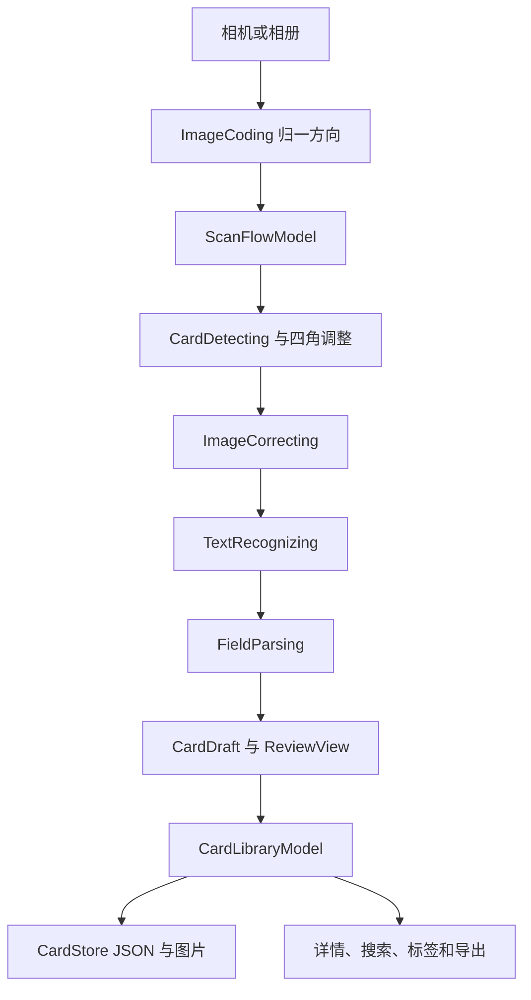

# CamCard 名片数字化与联系人管理

移动应用开发课程作业 · Specification-Driven Development 工程报告

## 1. 提交信息与验证环境

| 项目 | 记录 |
|---|---|
| 作者、学号、课程及班级 | 见作者填写的最终确认表 |
| 报告日期与时区 | 2026-11-07，Asia/Shanghai |
| 课程依据 | 移动应用开发课程作业-v2.pdf，第 1–18 节 |
| 实现切片 | 名片数字化与联系人管理 |
| 开发环境 | macOS 27.0.1、Xcode 27.2、iOS SDK 27.2 |
| 默认验证设备 | iPhone 18 Pro 模拟器、iOS 27.0 |
| 部署配置 | iOS 17.0 及以上，支持 iPhone 与 iPad |
| 代码组织 | SwiftUI、@Observable、协议注入、Codable JSON 与图片文件 |
| AI 辅助工具 | Codex 与 TRAE；使用者已确认大量使用 TRAE |
| 作者填写入口 | [最终确认表](../submission/final-signoff.md) |

本报告中的运行结果附有命令、日期、环境和证据位置。原始 OCR 测量来自固定语料 v2；系统 PhotosPicker 的人工记录来自 2026-10-28；iPhone 完整 UI 与识别评测记录来自 2026-11-07。每类证据在对应章节注明范围。

课程验收使用 T01–T20 定义的行为场景。仓库还包含针对字段歧义、文件失败、异步取消和导出内容的细化测试。测试方法数量描述代码中的检查入口，场景验收状态由具体运行条件和证据确定。

作者信息、指定版本 CamCard 的观察、真实设备操作和 TRAE 历史附件保留填写位置。已经完成的本地结果直接写入正文，等待作者提供的内容使用“待验证”“待观察”或“待填写”。

## 2. 业务任务与用户可见流程

用户从名片夹进入扫描，取得一张照片，确认照片质量，调整名片边界，执行识别与字段解析，核对内容并保存。保存后可以再次查看、编辑、搜索、添加标签、记录备注、删除和导出。该流程围绕一张具有稳定标识的名片记录展开。

### 2.1 拍摄与导入

相机拍摄进入照片预览，用户通过“重拍”和“使用这张”决定是否继续。预览页用于检查照片内容，裁剪页显示四角与校正范围。相册导入完成图片加载后进入裁剪，使用同一套检测、校正、识别、解析和保存逻辑。

扫描过程中可以取消。取消使当前操作标识失效，已在后台执行的结果返回时需要通过标识检查。扫描表单未保存时，名片记录及草稿标签保持未提交状态。用户重新选择图片、重拍或退出后，旧任务完成不能改变新的草稿。

### 2.2 确认与保存

OCR 结果显示为可编辑字段，用户能够修正姓名、公司、职位、电话、邮箱、网站和地址。多个号码保留各自类型，多个邮箱保留独立条目。未归类文字提供人工核对来源，初始解析及其证据随识别快照保存。

姓名为空时保存按钮禁用。保存成功关闭扫描流程，列表立即显示新记录；写入失败保留表单，显示失败原因，并允许用户处理后重新提交。用户看到的关闭动作与实际写入结果保持对应关系。

### 2.3 记录管理

列表显示姓名、公司与职位、首个号码、标签和缩略信息。进入详情可以查看字段及图片，在原图和校正图之间切换。编辑后的内容重新提交至文件库，并更新修改时间。搜索支持姓名、公司、职位、电话和邮箱，标签提供独立筛选条件。

| 用户动作 | 可见结果 | 数据要求 |
|---|---|---|
| 新增并保存 | 返回列表，新名片出现 | 图片与结构化记录可以重新读取 |
| 编辑并保存 | 详情显示修改值 | 更新同一 id 的记录 |
| 取消编辑 | 返回已有内容 | 草稿修改不提交 |
| 删除并确认 | 名片从列表消失 | JSON 提交后清理无引用图片 |
| 取消删除 | 名片仍可查看 | 原有记录及图片保持 |
| 终止并重新启动 | 找到原有名片与修改 | 从持久化文件恢复 |
| 导出 VCF | 获取标准联系人文件 | 使用当前已保存的字段 |

## 3. 参考行为、规格来源与观察范围

课程 PDF 给出功能边界、参考环境要求和 T01–T20。产品规格按照课程章节编号组织，参考测试套件保存每个场景的条件、操作和预期。正文通过这两类材料确定本地行为的检查条件。

### 3.1 参考环境记录

参考版本、iOS、设备、App 语言、登录状态、免费或会员范围会影响观察结果。它们统一填写在 [参考环境表](../submission/reference-environment.md)。当前没有教师另行提供版本及语料的记录，项目使用自建合成语料 v2。

指定版本的操作记录应包含输入、操作顺序、实际显示、数据变化及证据路径。例如删除操作应记录确认入口、确认与取消后的列表状态；保存操作应记录表单中的修改值和重新打开后的结果。对于登录限制或会员限制，记录实际限制及影响的用例范围。

### 3.2 六个观察维度

| 维度 | 观察对象 | 本地证据 | 正版状态 |
|---|---|---|---|
| UI | 页面、字段、按钮及状态提示 | 已有主要页面截图 | 指定版本待观察 |
| 交互 | 点击、返回、重拍、修改、筛选、删除 | UI 自动化与事件处理代码 | 待观察 |
| 状态 | 保存、取消、失败及重新进入后的页面 | 状态机、失败注入、UI 测试 | 待观察 |
| 数据 | 图片、字段、多值、标签、备注及导出内容 | 文件回读与 VCF 反序列化 | 待观察 |
| 异常 | 权限拒绝、空识别、读写失败和取消 | 权限映射与失败注入 | 待观察系统路径 |
| 流程 | 获取图片到管理和导出的连续操作 | 端到端场景及实际识别附件 | 待观察指定版本 |

### 3.3 已保存的官方资料

2026-10-30 归档的 CamCard 中文官网和 iPhone 帮助页涉及扫描识别、信息校对、已保存记录编辑、分组管理及通讯录保存。帮助页包含历史版本说明，资料日期和内容保存在 [差异分析](difference-analysis.md)及对应网页摘录中。

正版页面、同条件异常和同图字段结果在 [参考行为表](../submission/reference-observations.csv)及 [参考 OCR 表](../submission/reference-ocr.csv)保留记录位置。实际观察数量、图片范围和未完成原因由作者填写。

## 4. 规格拆解与可追溯关系

产品规格说明用户可见的行为，架构说明模块职责，测试提供具体输入和断言，运行附件保存执行结果。验收矩阵用 T 编号连接这些材料。每次修复关联相应规格和测试，防止只修改局部现象后遗漏其他场景。

### 4.1 需求到测试

| 规格 | 行为要求 | 检查依据 |
|---|---|---|
| 7.1.1 | 无记录时显示空名片夹和扫描入口 | T01 UI |
| 7.2.2 / 7.2.2.1 | 拍摄后预览，允许重拍与使用照片 | T04、预览重拍 UI |
| 7.2.3 | 相册加载的旧结果保持失效 | 异步加载竞态测试 |
| 7.3.1–7.3.5 | 边界、坐标、校正和整图处理 | 图像几何及像素回归 |
| 7.4.2 / 7.4.5 | OCR、初始字段和实际输入可追溯 | 识别快照与批量附件 |
| 7.5.5 / 7.5.7 | 缺失字段与联系方式中的组织词正确处理 | 字段反例、完整误填统计 |
| 9.1–9.5 | 人工编辑、保存条件、取消及未归类文字 | 表单与保存 UI |
| 12.1–12.5 | 立即写入、失败保持与重新读取 | 文件库失败注入、T18 |
| 13.1–13.2 | 导出当前记录，字段正确映射 | Contacts 与 VCF 回读 |

### 4.2 已有修订实例

R18 处理邮箱和网址中的组织关键词。对应反例检查 company、jobTitle 和 department，提交 02db310 记录初始修复，后续对连写公司后缀补充兼容测试。规则改变需要同时验证正例，避免屏蔽合法公司名称。

R23 处理相册加载完成顺序。测试控制两个异步操作的返回时间，分别覆盖旧成功、旧失败、重新拍摄、取消任务和替换选择。提交 b232f04 将图片加载纳入同一操作标识检查，状态规则与识别任务保持一致。

R24 处理首页读取失败。损坏或读取异常显示原因和重试入口；恢复前禁止扫描。提交 b9b243b 配合文件库及 UI 测试，验证重试可以读回原有记录。

本次识别证据补充从测试开始：旧记录往返编码后丢失原文、逐行结果、解析依据、置信度与图片标识，出现六项断言失败。补充记录结构及图片附件后，同一测试通过，完整检查继续通过。实际摘要见 [验证记录](verification-2026-11-07.md)。

## 5. 模块职责与协议设计

项目按领域模型、服务、持久化、功能界面和支持工具组织代码。界面通过装配后的服务访问能力，模型和状态逻辑依赖协议。相机、检测、识别、校正、解析、导出和存储具有明确输入输出。



### 5.1 服务接口

| 协议 | 输入 | 输出及失败语义 |
|---|---|---|
| CardDetecting | CGImage、方向 | Quad 或没有检测结果，允许整图继续 |
| ImageCorrecting | 图片及四角 | 校正后的图片；失败由流程提供恢复路径 |
| TextRecognizing | 实际识别输入、方向 | OCRResult；识别异常向调用者传播 |
| FieldParsing | OCRResult | ParsedCard，字段含值、置信度与依据 |
| ContactExporting | BusinessCard | VCF 数据或通讯录写入结果 |
| CameraPermissionProviding | 当前权限或请求动作 | 显式权限状态 |
| CardStore | 库与图片读写 | 加载值或抛出可显示的错误 |

AppServices.make 是依赖装配位置。生产配置创建系统服务；测试配置可以改变权限状态、存储类型、错误注入和图源。固定图源影响图片获取入口，检测、Vision 和规则解析仍由相应具体实现执行。

### 5.2 状态与并发

界面状态通过 @Observable 在主 actor 发布。AVCaptureSession 使用专门队列启动和停止。检测、透视校正、OCR 与字段解析在后台任务执行，结果返回时检查 operationID。相册加载也使用同一失效机制。

取消任务后，底层识别调用可能已经开始执行。状态安全由结果有效性检查保证：当前标识已经改变时，返回的值和错误均被忽略。测试同时检查界面能够响应取消，以及迟到结果保持失效。

### 5.3 设计决策材料

ADR-0001 记录 Vision 与 Core Image 选型；ADR-0002 记录规则解析；ADR-0003 记录文件持久化；ADR-0004 记录协议与固定测试图源；ADR-0005 记录工程生成与提交格式；ADR-0006 记录识别快照、完整测量与证据规则。具体文件见 [架构目录](../architecture/overview.md)。

## 6. 领域模型、草稿与时间语义

BusinessCard 代表保存后的名片，id 用于列表导航、更新和导出隔离。字段包含姓名、公司、职位、部门、电话集合、邮箱集合、网站、地址、标签、备注、图片标识、识别原文、识别快照和创建/修改时间。

### 6.1 字段表示

可选字符串允许为空，多电话和多邮箱采用数组。每个电话号码具有 kind 与 number，kind 为 mobile、office 或 fax。相同号码在不同明确类型下分别保留，同一类型内按数字去重。此规则允许名片上电话和传真使用同号的情况。

| 字段组 | 数据形式 | 具体用途 |
|---|---|---|
| 身份和排序 | UUID、createdAt、updatedAt | 定位记录，按修改时间排序 |
| 基础联系人 | String 与 String? | 姓名、公司、职位、部门、网址和地址 |
| 多值联系方式 | PhoneNumber 数组、邮箱数组 | 保留全部号码、类型和邮箱 |
| 管理信息 | 标签数组、备注 | 筛选、检索与补充记录 |
| 图像 | originalImageID、processedImageID | 找到独立图片文件 |
| 识别证据 | rawText、RecognitionSnapshot | 核对初始识别与后续修改 |

### 6.2 编辑草稿

CardDraft 用于确认页面和详情编辑。表单在草稿中增删电话和邮箱，保存时过滤空内容，并生成 BusinessCard。姓名的非空要求由 canSave 表达，字段是否存在由实际内容和用户确认决定。

标签新增和删除操作同样暂存草稿。取消表单会丢弃这些操作；保存时将名片变更与标签变更一次提交。全库标签删除需要同时从其他名片上移除，事务候选库用于保持记录一致。

### 6.3 初始快照与最终记录

RecognitionSnapshot 保存 OCRResult 与最初的 ParsedCard。之后修改姓名或公司会更新最终字段，初始快照继续保存第一次识别信息。RecognitionSnapshotTests 验证人工修改、再次编辑、写入和重新读取后的快照内容。旧 JSON 缺少 recognition 时仍可解码。

创建时间保留记录的初始时间，修改时间在实际提交时更新。搜索列表按 updatedAt 排序，修改后记录可以出现在较前位置。时间由可注入的 now 提供，测试能够稳定断言排序和提交结果。

## 7. 文件存储、提交顺序与恢复

文件库位于 App 的 Application Support/CamCardReplica。library.json 保存结构化记录，Images 目录保存按 UUID 命名的 JPEG 文件。JSON 采用可读缩进、稳定键排序和 ISO-8601 日期，便于检查具体字段与图片引用。

```text
CamCardReplica/
  library.json
  Images/
    <original-image-id>.jpg
    <processed-image-id>.jpg
```

### 7.1 新增记录

新增时生成两张图片的独立标识，写入图片文件，构造包含图片引用的候选记录及候选库。CardLibraryModel.commit 调用 CardStore.save，成功后发布 cards 和 tags。任何图片或 JSON 写入失败都会传播错误，新增路径清理本次已经写入的图片。

这条顺序使确认页面的关闭与 JSON 提交结果对应。失败时，用户可以继续检查表单、修改内容或重新保存；内存中的已提交库保持原有值。针对第二张图片写入失败、JSON 保存失败和重试成功均有测试。

### 7.2 编辑、标签和删除

编辑构建候选数组并替换相同 id 的元素，更新 updatedAt 后提交。标签标准化会去除空白、合并大小写不同的名称、去重并排序。删除动作先提交剩余记录，再计算仍被引用的图片集合，只删除已经没有引用的文件。

图片和 JSON 分别写入。进程如果在 JSON 已提交、旧图片尚未清理时终止，可能留下无引用图片；已提交记录的图片保持引用关系。该文件级边界在 ADR-0003 中记录，测试覆盖可控制的失败位置。

### 7.3 加载失败

文件不存在时返回空库；文件存在且无法解码时返回读取错误。CardLibraryModel 区分 loadError 与操作错误，加载恢复前拒绝提交候选库。首页显示原因和“重试”，避免用户在未知读取状态下继续创建记录。

重试调用 reload 重新读取原文件，成功后发布实际库并清除错误。测试检查读取失败、原文件保持、重新读取和恢复扫描入口。取消或失败不会自动创建一份空文件替换旧库。

### 7.4 重新启动证据

T18 使用独立 UUID 文件库运行：保存修改、标签、备注和图片，终止 App，重新启动，再打开同一记录检查姓名、公司、备注、标签以及原图/校正图。该 UI 用例执行实际 terminate/launch，文件库单元测试另行完整回读。

## 8. 相机、相册与 FauxCam 验证

CameraController 封装 AVCaptureSession、AVCapturePhotoOutput、会话队列与照片代理。配置时发现后置广角设备，创建 AVCaptureDeviceInput，将输入与照片输出加入会话。拍摄通过照片代理异步返回图像 Data，后续解码和流程转换由界面及模型完成。

### 8.1 权限状态

SystemCameraPermission 将系统状态转换为应用状态，只有 authorized 允许使用快门。首次请求、拒绝状态映射和界面禁用行为具有单元及注入 UI 测试。Xcode 模拟器专项使用真实系统服务完成已有授权、已有拒绝、首次弹窗允许及首次弹窗拒绝四项检查，全部通过，并保存系统弹窗截图。实际设备上的设置返回未验证，详见 [权限证据](evidence/permissions-2026-11-07/README.md)。

相册通过 PhotosPicker 提供选择结果，加载在异步入口完成。选择取消、空数据、损坏图片和加载错误具有明确处理。2026-10-28 已保存实际系统 PhotosPicker 的选取和取消截图。

### 8.2 固定图源与外部输入

常规 UI 回归使用 fixture-camera 启动配置，方便稳定检查预览、裁剪和后续表单。FauxCam 专项将 fixture-camera 设为 NO，使用实际快门按钮和正常 AVCapturePhotoOutput 回调取得图片。

本次从 [官方 FauxCam 发布页](https://github.com/mkemalgokce/fauxcam/releases/tag/v1.1.0)下载 v1.1.0 应用与对应 CLI，核对发布文件 SHA-256。应用安装在用户 Applications 目录，CLI 安装在用户 .local/bin。工具本体和动态库保留在本机，仓库保存测试代码、复现命令、截图及日志。

### 8.3 专项条件与记录

FauxCam 为指定测试进程提供图像输入。使用 en-01.png 合成名片，经本地帧服务进入模拟器。测试设置独立内存库，检查快门、照片预览、重拍、再次拍摄、裁剪、Vision、姓名字段、OCR 原文及保存结果。

专项运行与截图见 [FauxCam 验证记录](fauxcam-validation-2026-11-07.md)。视频授权状态在该工具中由其实现提供，系统权限由独立的模拟器专项验证。使用者没有 iPhone，真实拍照的光照、反光和对焦情况保留未验证状态。

## 9. 名片边界、坐标与透视处理

自动检测使用 VNDetectRectanglesRequest。配置将名片长边/短边比例限制在 1.25–2.4，最小尺寸为 0.15，角度容差为 35，最多保留三个候选，并按照 0.75、0.55、0.35 的置信度逐次尝试。

### 9.1 比例与候选选择

Vision 使用短边/长边比例，因此传入区间为 1/2.4 到 1/1.25。候选四边形经过面积和坐标检查后选择面积最大的对象。检测失败返回没有结果，由流程采用整图边界继续。

Quad 保存左上、右上、右下、左下四个角，坐标归一化为 0–1。面积使用四边形顶点计算，拖动后的坐标限制在图片范围。测试覆盖宽卡、方形、坐标钳制、透视输入和单个角被遮挡的情况。

### 9.2 坐标系转换

Vision 的原点位于左下角，界面和模型约定原点位于左上角。检测适配层执行 y = 1 - y；透视校正将归一化坐标乘以图片宽高，并转换回 Core Image 所用的纵向坐标。所有角点按同一顺序传入 CIPerspectiveCorrection。

照片进入流程时将 EXIF 方向应用到像素。检测、校正和 OCR 因而处理同一方向与坐标。图像方向测试检查旋转后宽高与像素位置，避免四角来自一个方向、图像使用另一个方向。

### 9.3 整图与错误恢复

quad 等于 fullFrame 时直接返回方向归一后的输入。R25 的像素回归发现，即使透视变换几何上保持整图，重采样与颜色处理仍可能改变小字像素，因此整图路径保留原始解码像素。

透视处理失败时使用输入图继续识别，识别失败则返回裁剪页面显示原因。用户可以重新调整或重拍。合成照片中的透视、阴影和遮挡提供固定回归输入，真实拍照条件由作者补充。

## 10. Vision 输出、阅读顺序与证据结构

文字识别采用 VNRecognizeTextRequest，level 为 accurate，语言为 zh-Hans 与 en-US，启用语言纠正，minimumTextHeight 为 0.008。请求使用实际校正图或整图输入，OCRResult 同时记录图片尺寸和处理耗时。

### 10.1 逐行数据

每个 Vision 观察保存第一候选文字、置信度和矩形。矩形转换到左上角原点后用于后续布局判断。rawText 按纵向位置排序并以换行拼接；ParsedCard 使用的 readingOrderedLines 会进一步将相近纵向位置视为同一行，并按横向位置排序。

这一区别影响两栏名片：原文用于保存观察内容，字段解析还需要结合相邻行、字号线索和位置。OCR 原文中可能存在重复标签或字符误识别，后续解析会进行文本归一与分类，原始观察继续保留。

### 10.2 置信度的含义

Vision 的逐行置信度随候选文字保存。ParsedValue 的置信度来自规则评分，两者在数据结构中分别记录。界面低置信提示使用解析候选值，不能从单个平均值确定整张名片是否全部正确。

本批数据包含邮箱字符错误和电话类型歧义。即使某些字段具有较高评分，用户仍需要核对原图与字段。报告通过逐图对 GT 测量记录实际错误，界面通过人工确认控制最终保存值。

### 10.3 原始证据附件

批量测试对每张图片记录 sourceSHA256、processedImageFile、processedImageSHA256、检测四角、处理方式、OCRResult、ParsedCard 和字段比较。实际识别输入编码为 PNG，作为 XCTest 永久附件保存。

导出工具从同一 xcresult 读取图片附件，按照 SHA-256 匹配记录，校验源图与 GT，再导出原文、初始字段、图片及统计。run.json 保存日期、设备、结果包、识别配置、GT 哈希和测量时 Swift 源文件哈希。具体文件说明见 [OCR 原始证据索引](evidence/ocr-2026-11-07/README.md)。

## 11. 字段解析规则与证据评分

HeuristicFieldParser 接收 OCRResult，输出 ParsedCard。它处理文本归一、阅读顺序、联系方式提取、姓名与组织字段评分、地址证据及低置信过滤。每个候选保存实际值、confidence 和 evidence，方便界面展示和错误追溯。

### 11.1 文本与联系方式保护

TextNormalizer 统一常见标点、标签和文字空白，并为中英文混排提供处理。邮箱和网址使用正则提取；其他分类规则检查文字时屏蔽已经识别的联系方式区间，减少域名中的公司、职位或部门关键词参与评分。

电话号码扫描同样屏蔽邮箱和网址占用范围，防止邮箱用户部分的长数字被当成号码。地址规则排除联系方式中的数字和地址词，避免电话、邮箱及网址构成虚假的邮编或街道证据。

### 11.2 姓名、公司和职位

姓名候选结合文字位置、字号线索、称谓与其他字段特征。公司规则使用机构词表和法律后缀，职位规则扣除机构等冲突证据后要求净分为正。没有合格职位候选时保留空值，防止从负分候选中选取一个结果。

部门字段使用部门词表与组织上下文。原文中存在一行文字，并不保证规则能够正确分配；本次 department 测量保留漏提取情况。用户可以通过未归类文字和原图修正。

### 11.3 电话标签与格式

PhoneClassifier 识别 Mobile、Tel、Fax 及中文标签。同行多个号码根据各自位置关联最近标签。明确标签的候选评分为 0.96。没有标签时依据号码格式提供候选：中国手机格式评分 0.88，区号样式座机评分 0.82，部分服务号码评分 0.78，国际或其他格式使用较低评分。

| 输入依据 | 当前处理 | 保留的风险 |
|---|---|---|
| 明确 Mobile / 手机标签 | 分类为 mobile | OCR 可能识别错误标签或号码 |
| 明确 Tel / 电话标签 | 分类为 office | 标签位置可能受排版影响 |
| 明确 Fax / 传真标签 | 分类为 fax | 标签缺失会削弱依据 |
| 同号、不同明确类型 | 各自保留 | 导出时需保持两个标签 |
| 无标签、区号格式 | 提供 office 候选 | 传真也可能使用同类格式 |
| 无标签、国际格式 | 提供较低置信候选 | 手机与办公电话存在歧义 |

本次 zh-06 的号码被分类为座机，GT 将其定义为传真。号码格式无法提供该类型所需的全部证据，完整集合测量继续记为错误，界面允许人工修改类型。

### 11.4 网站、地址与缺失字段

网站候选需要 www/http(s) 前缀或网站标签。无法确认的裸域名保留为未归类文字。该规则来自邮箱 @ 被 OCR 丢失后误生成网站的回归案例，也会增加部分无标签网址的人工填写工作。

地址可以使用非空 Address/Add/地址标签、门牌号与街道词、行政区和邮编等证据。测试包含短地址、空标签、孤立街道词、联系方式中的数字和复合街道后缀。

低于保留阈值的候选被过滤，界面针对保留的低置信字段显示核对提示。缺失字段测试单独检查没有网站时的输出，完整测量还检查其他字段的缺失误填。规则评分、固定语料统计与人工核对共同提供检查依据。

## 12. 人工确认、草稿取消与保存错误

ReviewView 将识别输出转为 CardDraft，提供字段表单、低置信提示、OCR 原文与未归类文字。用户能够添加、修改和删除号码或邮箱条目，并选择电话号码类型。标签与备注随草稿保留，确认保存时提交。

### 12.1 用户核对内容

用户需要核对字符、字段类别及多值完整性。例如 contact01 与 contactol 的差异涉及字符，office 与 fax 涉及类别，漏掉第二个邮箱涉及集合完整性。这些问题在界面上使用相应文本或类型控件修改，最终保存内容来自确认后的草稿。

OCR 原文弹层显示初始解析结果和依据，并保留逐行置信度。用户可以查看规则为什么选取某个字段，再结合原图确定修改。确认页顶部的置信度是对当前候选评分的汇集，完整性由具体字段核对和测试检查。

### 12.2 空值与修改

空白输入在生成保存记录时归一为空值，空的号码和邮箱不保留。姓名要求非空，这一条件同时用于保存按钮和模型保存入口。OCR 完全没有文字时允许进入空表单，用户填写姓名后可以继续保存。

标签新增与全库标签删除记录在草稿中。确认页面或详情编辑取消后，未提交的标签保持丢弃状态。标签大小写归一化、删除影响其他名片等逻辑通过库模型单元测试检查。

### 12.3 错误反馈

保存失败时页面保留字段，显示错误并允许重新操作。存储异常向模型和界面传播，提交成功后才关闭流程。测试通过失败 store 检查原库、候选记录和图片清理；UI 测试检查保存失败提示与表单保留。

后台识别失败时返回裁剪，用户可以重新调整或重拍。取消后迟到的错误和成功结果均需要通过操作标识检查。相册加载失败和识别失败分别保留原因，避免旧任务错误覆盖正在处理的新图片。

作者实际修改的值、不同字段修改数量、编辑动作次数、操作日期及附件保存在 [人工修改表](../submission/manual-corrections.csv)。这些数据目前由作者填写。

## 13. 名片列表、检索与标签管理

CardLibraryModel 提供按查询和标签过滤后的记录，并按 updatedAt 倒序排序。列表通过记录 id 进入详情，新增或编辑提交后由观察状态刷新。读取失败提供独立错误页面，成功恢复前禁用扫描。

### 13.1 搜索内容与数字归一

BusinessCard.searchableText 包含姓名、公司、职位、部门、地址、备注、网站、号码、邮箱和标签，合并后转换为小写。查询去除首尾空白；空查询返回全部记录。

纯数字和加号形式的查询先提取数字，在电话的数字部分中进行包含匹配。因此保存为带空格或连字符的号码可以通过连续数字查找。其他文本使用归一后字符串包含关系，测试覆盖姓名、公司、职位、电话与邮箱。

### 13.2 标签语义

标签具有名称与用于标识的大小写归一值。创建时去除空白，已有同名标签使用规范名称；给名片附加标签后可以在列表筛选。删除全库标签会从标签集合和所有记录中移除。

筛选与搜索可以组合：先检查标签，再检查查询。测试覆盖标签创建、附加、筛选、大小写和删除后的重新读取。确认或编辑期间的标签变化在草稿中暂存，保存时一次提交。

### 13.3 详情与外部入口

详情显示保存字段和图片。点击图片打开查看器，允许切换原图与校正图；电话号码、邮箱和网站提供系统 URL 入口。删除具有确认步骤，列表左滑删除与详情删除均支持取消。

备注可以用于记录会议、来源和后续联系信息，随记录持久化并参与搜索。它与原始 OCR 文字分别保存，用户备注不覆盖识别证据。详情的当前字段也是导出数据来源。

## 14. 联系人映射、VCF 与导出更新

ContactsExporter 将 BusinessCard 转为 CNMutableContact，再使用 CNContactVCardSerialization 生成 VCF。保存到通讯录时请求系统授权，成功后使用 CNSaveRequest 写入；拒绝或编码失败通过错误返回。

| 名片内容 | 联系人字段或标签 | 处理规则 |
|---|---|---|
| 姓名 | givenName / familyName | 拉丁姓名使用最后一部分作为 familyName；含中文时保留完整姓名 |
| 公司 | organizationName | 空值转换为空字符串 |
| 职位 | jobTitle | 保留当前已保存值 |
| 部门 | departmentName | 按当前字段映射 |
| 手机 | mobile 标签 | 保留每个号码 |
| 座机 | work 标签 | 保留每个号码 |
| 传真 | workFax 标签 | 同号不同类型继续分别导出 |
| 邮箱 | work 标签邮箱集合 | 保留全部邮箱 |
| 网站 | URL 地址 | 必要时补充链接协议用于打开地址 |
| 地址 | postalAddresses.street | 整体保存当前地址字符串 |
| 备注 | note | 非空时赋值 |

VCardDocument 是当前已保存名片的 Transferable 值，分享时生成文件。文件使用 UUID 位置，编辑后导出使用新值，同名联系人的文件相互独立。VCardDocumentTests 修改公司、职位、电话、邮箱、地址和网站后导出，重新解析生成的 VCF 并逐字段断言。

测试同时保留编辑前文件，检查旧文件内容与新记录之间的关系；另一个测试检查同名名片的导出路径和内容。ContactsExporterTests 检查电话号码标签、中文姓名、拉丁姓名和全部字段映射。

课程允许采用系统通讯录或 VCF。当前提交有 VCF 自动化证据，系统通讯录实际授权、拒绝和落入联系人列表的人工结果保留待验证状态。作者可根据实际导出方式填写最终确认表。

## 15. 测试分层、运行结果与验收记录

测试目录包含纯逻辑单元测试和图像集成测量。UI 测试检查用户操作和页面状态。Python 工具检查验证语料字体与构建路径，证据检查验证失败运行、数据缺失、哈希变化和字段不一致等拒绝条件。

### 15.1 当前测试组织

| 类别 | 方法数量 | 内容 |
|---|---:|---|
| 单元测试 | 102 | 模型、库、规则、图片、权限、快照与导出 |
| 集成测量 | 7 | 理想文本、九个 fixture 与全部图片 |
| UI 定义 | 27 | 24 个常规功能方法、截图方法、FauxCam 专项与系统权限专项 |
| Python 检查 | 8 | 工具检查 3 项，证据检查 5 项 |

### 15.2 本地运行证据

| 执行项 | 日期与环境 | 实际结果 |
|---|---|---|
| make verify | 2026-11-07 / Xcode 27.2 / iOS 27.0 | 109 个单元/集成方法，0 个非预期失败 |
| make bench | 同日同设备 | 7 个评测方法通过，76 个输入均产生记录 |
| 原有完整 iPhone UI | 同日 20:18 开始 | 24 个功能方法通过，1 个截图方法默认跳过 |
| FauxCam 专项 | 同日 / FauxCam 1.1.0 | 1 个方法通过；正常快门、重拍、识别、原文与保存，19.0 秒 |
| 系统权限专项 | 同日 / 未加载 FauxCam | 四种权限条件分别通过，保存原生系统弹窗截图 |
| Python 工具检查 | 同日 | 3 项通过 |
| Python 证据检查 | 同日 | 5 项通过 |
| 文档与文件检查 | 同日 | 文档路径、命令、统计和归档文件校验通过 |

FauxCam 方法通过配置文件显式启用，默认测试不加载外部工具。截图方法也采用显式启用条件。常规完整 UI 的运行结果与新增专项分别保存，实际执行数量在相应日志中记录。

无标签电话号码的既有歧义保留 XCTExpectFailure，完整集合与误填统计继续计错。iPad UI 使用 2026-10-28 的历史运行结果，旧系统 runtime 的最后一次交互调整尚待复验。远端 CI 执行 Linux 文档审计，本地 Xcode 结果附独立证据。

### 15.3 T01–T20 状态

| 编号 | 场景 | 本地证据与待填写范围 |
|---|---|---|
| T01 | 首次启动 | 空状态 UI 通过 |
| T02 | 进入扫描 | 扫描入口 UI 通过 |
| T03 | 权限 | 状态映射、拒绝注入与模拟器原生系统弹窗允许/拒绝通过 |
| T04 | 拍摄 | 固定图源回归及 FauxCam 正常快门专项通过 |
| T05 | 导入 | 实际系统 PhotosPicker 选取/取消历史截图 |
| T06 | 边界 | 倾斜、遮挡、坐标和手动裁剪测试 |
| T07 | OCR | 全部 76 个输入的原始输出 |
| T08 | 字段 | 完整集合测量与规则反例，正版同图待观察 |
| T09 | 缺失网站 | 专项测试及缺失输入误填统计 |
| T10 | 多号码 | 明确标签和同号不同类型测试；无标签错误继续计分 |
| T11 | 人工修改 | 修改后保存 UI 通过；作者实际案例待填写 |
| T12 | 保存 | 保存并返回列表 UI 通过 |
| T13 | 详情 | 字段显示及原图切换 UI 通过 |
| T14 | 编辑 | 修改后详情更新 UI 通过 |
| T15 | 搜索 | UI 与领域模型查询测试 |
| T16 | 标签 | 筛选 UI、草稿与大小写规则测试 |
| T17 | 删除 | 确认与取消删除 UI 通过 |
| T18 | 持久化 | 模拟器真实终止/重新启动及文件回读 |
| T19 | 导出 | VCF 完整字段反序列化与最新值测试 |
| T20 | 异常 | 取消、空结果、识别/读取/保存失败注入 |

每个场景的规格、测试名与实现位置见 [验收矩阵](../spec/acceptance.md)。指定版本的六个维度观察保持待填写。

## 16. 合成语料、GT 与样本分布

语料由 Scripts/generate_test_cards.py 生成，seed 固定为 20261027。v2 保留 50 张合成名片的业务字段，采用不同字体家族生成图像，并同步九个 App fixture。GT、manifest 与原始图片一同保存。

50 个平面图像之外，固定生成透视/旋转与桌面背景、边缘遮挡以及照片遮挡变体，总计 76 个图像输入。边缘遮挡覆盖页边距，检测测试检查轮廓部分遮挡后的结果。照片变体使用固定合成变换和纹理。

### 16.1 图片构成

| 图片类别 | 数量 | 构成 |
|---|---:|---|
| flat | 50 | 清晰平面名片 |
| photo | 12 | 透视、轻微旋转、桌面和阴影 |
| occluded | 10 | 名片边缘部分遮挡 |
| occluded-photo | 4 | 照片变体与边缘遮挡结合 |

| 统计维度 | 类别 | 图片数量 |
|---|---|---:|
| 语言 | zh | 26 |
| 语言 | en | 21 |
| 语言 | bilingual | 29 |
| 版式 | classic | 19 |
| 版式 | centered | 20 |
| 版式 | two-column | 16 |
| 版式 | vertical | 12 |
| 版式 | minimal | 9 |
| 电话标签 | True | 56 |
| 电话标签 | False | 20 |

不同图片可能对应同一张名片，变体之间共享业务 GT。字段指标以图像为计分单位，因此图像总数用于分母。报告同时提供 flat 组统计，便于查看基础合成名片的结果。

### 16.2 GT 与缺失信息

每条 GT 包含图片文件名、语言、版式、字体、标签条件、实际字段和缺失字段说明。字段中的多号码具有类型，多邮箱保留全部值。评测加载全部图片并核对文件集合，防止遗漏样本后继续计算。

名片使用虚构姓名、公司、示例域名与固定测试号码。原始图片保持脚本生成结果，测试和文档修改过程中没有手工改变语料图片。生成器的字体选择与文本边界由 Python 工具检查验证。

### 16.3 可复现条件

重建语料需要 Pillow、NumPy 及指定字体。字体缺失时生成器给出错误，font_file 记录实际字体来源。环境和字体变化会影响像素及识别输出，语料版本与测试环境随报告保存。

本次证据补充保持现有语料和 GT。实际识别输入是当次检测/校正后的 PNG，另有对应哈希。原图、处理图、OCR 和字段比较可以按同一个文件名关联。

## 17. 计分口径与字段级结果

完整集合比较对每类字段的全部值进行计分。值去除首尾空白并忽略大小写，电话号码内部格式继续保留。集合中漏掉第二个邮箱或多出一个号码都会导致该字段整项错误。空字符串与空值统一表示缺失。

### 17.1 三类测量输入

| 测量 | 输入 | 检查对象 |
|---|---|---|
| 理想文本首值门槛 | 用 GT 组成的理想文字 | 保留历史解析回归要求 |
| 理想文本完整集合 | 全部号码、邮箱及字段 | 漏值、多值与缺失误填 |
| 实际图像完整集合 | 检测、校正、Vision、解析 | 图像到字段的完整结果 |

理想文本首值结果中 name/company/jobTitle/email/website/address 各为 50/50，mobile 为 50/50、office 为 49/50、fax 为 45/50。完整集合文本结果中 department 为 43/50、mobile 为 46/50、office 为 49/50、fax 为 45/50。原有门槛保持。

### 17.2 图像到字段的完整集合准确率

“全部正确”包含字段原本缺失且输出为空的情况；“已印字段正确”单独统计 GT 非空的图片；缺失误填只使用原本没有该字段的输入作分母。

| 字段 | 全部正确 | 准确率 | 已印字段正确 | 缺失误填 | 漏值 | 多值 |
|---|---:|---:|---:|---:|---:|---:|
| 姓名 | 74/76 | 97.4% | 74/76 | 0/0 | 2 | 2 |
| 公司 | 72/76 | 94.7% | 72/76 | 0/0 | 4 | 4 |
| 职位 | 70/76 | 92.1% | 70/76 | 0/0 | 6 | 6 |
| 部门 | 63/76 | 82.9% | 37/50 | 0/26 | 13 | 2 |
| 邮箱集合 | 47/76 | 61.8% | 47/76 | 0/0 | 31 | 27 |
| 网站 | 66/76 | 86.8% | 46/56 | 0/20 | 10 | 10 |
| 地址 | 44/76 | 57.9% | 25/57 | 0/19 | 32 | 32 |
| 手机集合 | 69/76 | 90.8% | 69/76 | 0/0 | 1 | 7 |
| 座机集合 | 72/76 | 94.7% | 28/31 | 1/45 | 3 | 4 |
| 传真集合 | 69/76 | 90.8% | 10/17 | 0/59 | 7 | 0 |

姓名在全部图片中正确 74 次，邮箱集合正确 47 次，地址正确 44 次。地址和邮箱存在较多字符及格式差异，需要在错误记录中检查原文和初始解析。座机缺失时有 1/45 误填，缺失网站有 0/20 误填。

### 17.3 值级精确率、召回率与 F1

值级统计将每个实际联系方式或字段值单独计分。TP 为期望值数量减去漏值，FP 为多值数量，FN 为漏值数量；Precision = TP/(TP+FP)，Recall = TP/(TP+FN)，F1 = 2TP/(2TP+FP+FN)。这些数字使用与完整集合相同的归一与匹配规则。

| 字段 | TP | FP | FN | Precision | Recall | F1 |
|---|---:|---:|---:|---:|---:|---:|
| 姓名 | 74 | 2 | 2 | 97.4% | 97.4% | 97.4% |
| 公司 | 72 | 4 | 4 | 94.7% | 94.7% | 94.7% |
| 职位 | 70 | 6 | 6 | 92.1% | 92.1% | 92.1% |
| 部门 | 37 | 2 | 13 | 94.9% | 74.0% | 83.1% |
| 邮箱集合 | 53 | 27 | 31 | 66.2% | 63.1% | 64.6% |
| 网站 | 46 | 10 | 10 | 82.1% | 82.1% | 82.1% |
| 地址 | 25 | 32 | 32 | 43.9% | 43.9% | 43.9% |
| 手机集合 | 75 | 7 | 1 | 91.5% | 98.7% | 94.9% |
| 座机集合 | 28 | 4 | 3 | 87.5% | 90.3% | 88.9% |
| 传真集合 | 10 | 0 | 7 | 100.0% | 58.8% | 74.1% |

完整集合指标反映一张名片某字段是否全部正确，值级指标反映具体值的漏提取与多提取。它们在多邮箱、多电话条件下具有不同计分单位，报告保留两类结果和原始比较。

### 17.4 按输入条件切分

| 图片组 | 姓名 | 公司 | 职位 | 邮箱集合 | 网站 | 地址 |
|---|---:|---:|---:|---:|---:|---:|
| flat | 49/50 | 47/50 | 47/50 | 32/50 | 47/50 | 32/50 |
| photo | 11/12 | 12/12 | 11/12 | 8/12 | 9/12 | 4/12 |
| occluded | 10/10 | 9/10 | 9/10 | 6/10 | 8/10 | 5/10 |
| occluded-photo | 4/4 | 4/4 | 3/4 | 1/4 | 2/4 | 3/4 |

| 语言 | 姓名 | 公司 | 职位 | 邮箱集合 | 网站 | 地址 |
|---|---:|---:|---:|---:|---:|---:|
| zh | 26/26 | 26/26 | 26/26 | 13/26 | 17/26 | 16/26 |
| en | 20/21 | 20/21 | 20/21 | 16/21 | 21/21 | 13/21 |
| bilingual | 28/29 | 26/29 | 24/29 | 18/29 | 28/29 | 15/29 |

全部字体、版式、电话标签、语言与图片种类的统计保存在 [metrics.csv](evidence/ocr-2026-11-07/metrics.csv)。合成图像分布固定，真实拍摄与正版相同输入结果等待实际记录。

## 18. 错误案例与定位依据

每个案例使用同一次测量的 GT、实际识别输入、OCR 原文和初始字段。原文中已经出现的字符差异可以定位至识别结果；原文保留期望文字、字段结果仍为空或分类错误时，可以继续检查提取规则与 evidence。

### 18.1 邮箱数字与近形字符：zh-01.png

GT：["contact01@example.com"]。初始结果：["contactol@example.com"]。漏值 1，多值 1。

[原始图片](../../TestData/cards/zh-01.png) · [当次识别输入](evidence/ocr-2026-11-07/images/processed-zh-01.png) · [初始解析依据](evidence/ocr-2026-11-07/parsed/zh-01.png.json)

```text
朱宏明
教授
同济大学
计算机科学与技术学院
手机：+86 138 0000 1234
电话：021-6000 1234
传真：021-6000 1235
Email: contactol@example.com
Web: www.example0l.com
Add：上海市杨浦区四平路1239号 200092
```

实际字符与字段输出保存在附件中。核对原图、原文和候选依据后，可以确定字符误识别及后续归类的影响。作者实际修改值和修改动作数量保留在人工修改表。

### 18.2 公司名称中的字符变化：en-01.png

GT：["ABC Technologies"]。初始结果：["ABC Technologles"]。漏值 1，多值 1。

[原始图片](../../TestData/cards/en-01.png) · [当次识别输入](evidence/ocr-2026-11-07/images/processed-en-01.png) · [初始解析依据](evidence/ocr-2026-11-07/parsed/en-01.png.json)

```text
David Chen
Technical Director
ABC Technologles
Platform Engineering
Mobile： +1 415 000 1234
Tel： +1415 000 8000
Email: david.chen@example.org
Email: info@example.org
Web:www.abc.example
Add: 500 Market Street, Suite 900, San Francisco, CA 94105
```

实际字符与字段输出保存在附件中。核对原图、原文和候选依据后，可以确定字符误识别及后续归类的影响。作者实际修改值和修改动作数量保留在人工修改表。

### 18.3 照片变体中的姓名字符：en-03-photo.jpg

GT：["Michael O'Brian"]。初始结果：["Michae1 o'Brian"]。漏值 1，多值 1。

[原始图片](../../TestData/cards/en-03-photo.jpg) · [当次识别输入](evidence/ocr-2026-11-07/images/processed-en-03-photo.png) · [初始解析依据](evidence/ocr-2026-11-07/parsed/en-03-photo.jpg.json)

```text
Michae1 o'Brian
VP Sales
Bright Harbor Logistics
G1obal Accounts
Mobile: Mobile： +44 20 0000 9012
Te1： +49 30 00006000
Tel：
Emai1:Emai1:michael.obrian@example.org
Web: www.bright.example
Web：
Add: Friedrichstrasse 88,10117 Berlin, Germany
Add：
EN
```

实际字符与字段输出保存在附件中。核对原图、原文和候选依据后，可以确定字符误识别及后续归类的影响。作者实际修改值和修改动作数量保留在人工修改表。

### 18.4 无标签传真分类：zh-06.png

GT：["0755-2000 9013"]。初始结果：[]。漏值 1，多值 0。

[原始图片](../../TestData/cards/zh-06.png) · [当次识别输入](evidence/ocr-2026-11-07/images/processed-zh-06.png) · [初始解析依据](evidence/ocr-2026-11-07/parsed/zh-06.png.json)

```text
刘晓峰
合伙人
海通律师事务所
知识产权
+86 188 0000 2211
0755-2000 9013
contact06@example.com
www.example06.com
```

原文保留号码但缺少类型标签，号码格式规则给出座机候选。GT 将该号码定义为传真，office 和 fax 两类分别按实际差异计分。界面允许修改电话类型。

### 18.5 地址内部空白：zh-02.png

GT：["北京市海淀区中关村大街1号 100080"]。初始结果：["北京市海淀区中关村大街1号100080"]。漏值 1，多值 1。

[原始图片](../../TestData/cards/zh-02.png) · [当次识别输入](evidence/ocr-2026-11-07/images/processed-zh-02.png) · [初始解析依据](evidence/ocr-2026-11-07/parsed/zh-02.png.json)

```text
李静
技术总监
华远科技股份有限公司
研发中心
手机：+86 139 0000 5678
Email: contacto2@example.com
Web:www.example02.com
Add：北京市海淀区中关村大街1号100080
```

实际原文中的门牌与邮编之间空白与 GT 有差异。当前匹配规则保留内部格式，因此该项计为错误；原文和比较数组同时保存这一差异。

### 18.6 部门字段漏提取：zh-03.png

GT：["运营管理部"]。初始结果：[]。漏值 1，多值 0。

[原始图片](../../TestData/cards/zh-03.png) · [当次识别输入](evidence/ocr-2026-11-07/images/processed-zh-03.png) · [初始解析依据](evidence/ocr-2026-11-07/parsed/zh-03.png.json)

```text
王建国
副总经理
东方物流集团
运营管理部
手机：
+86137 00009012
contact03@example.com
Emal：
www.example03.com
W'cb：
ZH
```

部门提取结果为空。可以从上方原文检查部门文字是否出现，再结合未归类文字和其他字段分配定位规则原因；本次保留实际漏值计数。

### 18.7 职位字段错误：en-04.png

GT：["Product Manager"]。初始结果：["Proauct Manager"]。漏值 1，多值 1。

[原始图片](../../TestData/cards/en-04.png) · [当次识别输入](evidence/ocr-2026-11-07/images/processed-en-04.png) · [初始解析依据](evidence/ocr-2026-11-07/parsed/en-04.png.json)

```text
Sarah Kim
Proauct Manager
Lumen Health Systems
Clinical Products
Mobile： +49 30 0000 3456
Email: sarah.kim@example.org
Web: www.lumen.example
```

实际字符与字段输出保存在附件中。核对原图、原文和候选依据后，可以确定字符误识别及后续归类的影响。作者实际修改值和修改动作数量保留在人工修改表。

### 18.8 多邮箱及识别完整性：bi-11.png

GT：["biz11@example.com", "sales11@example.net"]。初始结果：["1@example.com", "salesl1@example.net"]。漏值 2，多值 2。

[原始图片](../../TestData/cards/bi-11.png) · [当次识别输入](evidence/ocr-2026-11-07/images/processed-bi-11.png) · [初始解析依据](evidence/ocr-2026-11-07/parsed/bi-11.png.json)

```text
朱宏明 Zhu Hongming
教授 Professor
同济大学 Tongii University
计算机学院 School of CS
Mobile： +86 137 0000 9012
Mobile：
Tel: 021-6000 1234
Tel：
Email: biz1 1@example.com
Email：
Email: salesl1@example.net
Emall
Web: www.example1l.com
Web：
BILINGUAL
```

实际字符与字段输出保存在附件中。核对原图、原文和候选依据后，可以确定字符误识别及后续归类的影响。作者实际修改值和修改动作数量保留在人工修改表。


## 19. 可靠性修复、AI 协作与能力边界

### 19.1 保存与取消的回归保护

历史审查发现保存失败后的页面关闭、删除失败前清理图片、草稿标签提前提交、原图入口缺失和编辑后导出旧内容等问题。修复通过候选库提交、写入错误传播、图片清理顺序、草稿事务和按当前值生成导出文件处理。

对应测试保留失败 store、第二张图片失败、重试、完整文件回读、删除取消和同名导出隔离。测试断言用户看到的页面与文件内容，异常恢复和正常保存共享同一数据入口。

### 19.2 异步与读取错误

检测、识别和相册加载使用任务标识。替换图片或取消流程后，旧成功与旧错误均不更新当前状态。读取失败与空库分别显示，恢复前禁止写入。异步控制测试、读取失败测试和 UI 重试共同检查这些行为。

这些修复围绕具体错误、输入与可观察后果进行记录。Git 历史保存问题对应提交；修复前审查报告保留当时基线；当前规格与验收矩阵记录完成后的契约。

### 19.3 Codex 与 TRAE 的实际使用

项目使用 Codex 与 TRAE。使用者于 2026-11-07 确认大量使用 TRAE，具体日期、任务和截图由使用者在 [TRAE 模板](../ai-collaboration/trae-record-template.md)补充。本次 Codex 的作业核实、原始证据测试、文档整理、FauxCam 验证与提交操作记录在 [协作目录](../ai-collaboration/README.md)。

[开发提示词记录](../ai-collaboration/development-prompts.md)按实际任务保存审查、修复、同步、证据整理与相机验证的提示词、人工决定和产物。

任务约束包括现有架构、服务接口、允许修改范围、固定语料和回归要求。本次证据工作保留了修改前六项断言失败、修改后通过和完整验证。Python 检查针对缺失原文、失败运行、图片变化、重复输入和比较不一致设置拒绝条件。

人工决定负责确认实际使用情况、参考版本观察、是否采用修改和最终验收。代码变化的工具归属按照真实对话记录填写；Git 提交、测试结果和工具附件通过任务编号关联。

### 19.4 识别与解析的边界

OCR 原文可能包含近形字符、标签重复、漏字和空白变化。规则分类可能因无标签号码、组织词歧义、复杂版式和部门候选冲突产生错误。当前报告保存这些错误的实际值和计数，并提供原图、处理图、原文及初始字段。

规则采用 evidence 和阈值控制候选，无法确认的网站和部分文字留在未归类内容。Apple 上下文测试包含孤立词、姓名后的公司候选和地址中同词三种输入。字段决定需要结合实际上下文，产品通过人工确认保存最终联系人。

竖排文字、艺术字、强反光、多名片同框及真实拍照质量仍有验证限制。FauxCam 证明指定虚拟输入下的快门和回调接口流程，系统权限另有四项模拟器实际记录；物理拍摄条件未验证。

## 20. 提交文件、复现与作者填写

### 20.1 提交目录

| 材料 | 位置与用途 |
|---|---|
| 最终报告 | 当前 Markdown 文件，直接编辑并随附件提交 |
| 产品与数据规格 | docs/spec，包含编号条款与验收追溯 |
| 架构与接口 | docs/architecture、docs/api |
| 源码与测试 | Sources、Tests、UITests、project.yml |
| 固定语料 | TestData 与生成脚本 |
| OCR 证据 | evidence/ocr-2026-11-07，原文、初始字段、实际输入和哈希 |
| 系统权限证据 | evidence/permissions-2026-11-07，四项实际结果、系统弹窗、API 探测与哈希 |
| FauxCam 证据 | evidence/fauxcam-2026-11-07，截图、实际条件和测试摘要 |
| 工具与协作 | Scripts、docs/ai-collaboration |
| 作者填写 | docs/submission，简明操作清单与数据表 |

### 20.2 构建与测试

```bash
make bootstrap
make verify
make bench
make test-evidence
make audit
```

系统权限专项使用 make test-camera-permissions；常规 UI 使用 make test-ui；FauxCam 专项的配置、工具路径和命令见 [专项记录](fauxcam-validation-2026-11-07.md)。报告导出参数明确填写实际日期、设备和结果包，完整示例见 [验证记录](verification-2026-11-07.md)。

提交包通过 make package 生成，包含 Markdown、图片、原始证据、可执行检查脚本、MANIFEST.sha256 和 SUBMISSION.json。打包检查源文件哈希、证据哈希、ZIP CRC 和归档内容。作者填写真实数据后更新正文和压缩包。

### 20.3 作者填写入口

[个人清单](../submission/user-actions.md)保留三项：正版资料、已有 TRAE 附件与最终提交信息。相机权限已完成模拟器系统验证，使用者无需准备 iPhone。[最终确认表](../submission/final-signoff.md)集中填写姓名、学号、设备、日期、实际完成范围及仍未验证项目。

正版版本与同图统计保留待观察；实际拍照质量保留未验证；TRAE 具体任务附件、作者修改与演示结果保留待填写。现有本地检查及图片测量可以按正文证据直接引用。

### 20.4 界面与实测附件


### 20.5 资料定位

课程用例来源见 [参考测试套件](../testing/reference-test-suite.md)；官方资料日期与链接见 [差异分析](difference-analysis.md)；逐图字段比较见 [完整图像统计](image-accuracy-latest.md)；识别输出见 [原始证据索引](evidence/ocr-2026-11-07/README.md)；具体命令和运行摘要见 [验证记录](verification-2026-11-07.md)。
