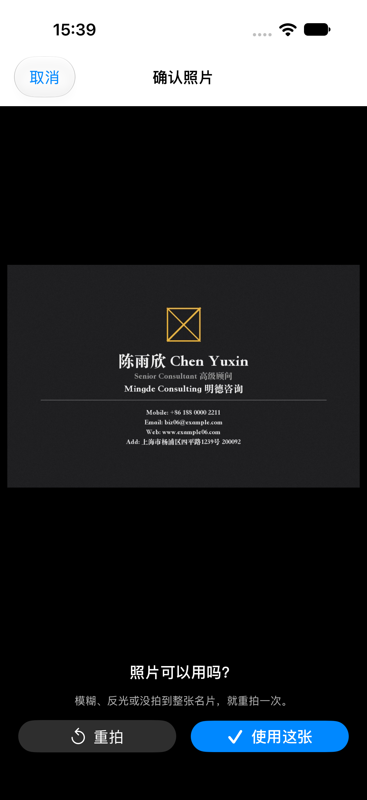
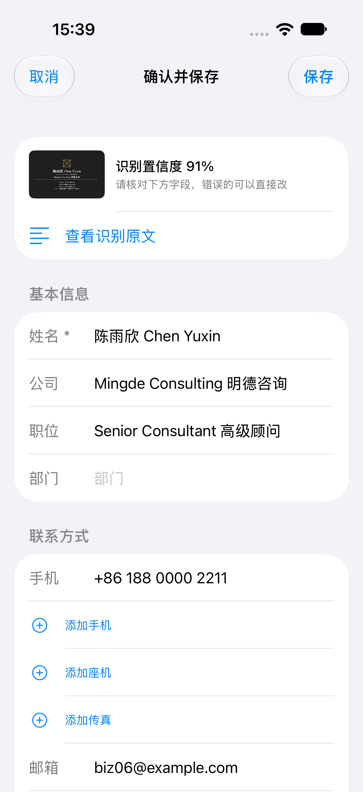
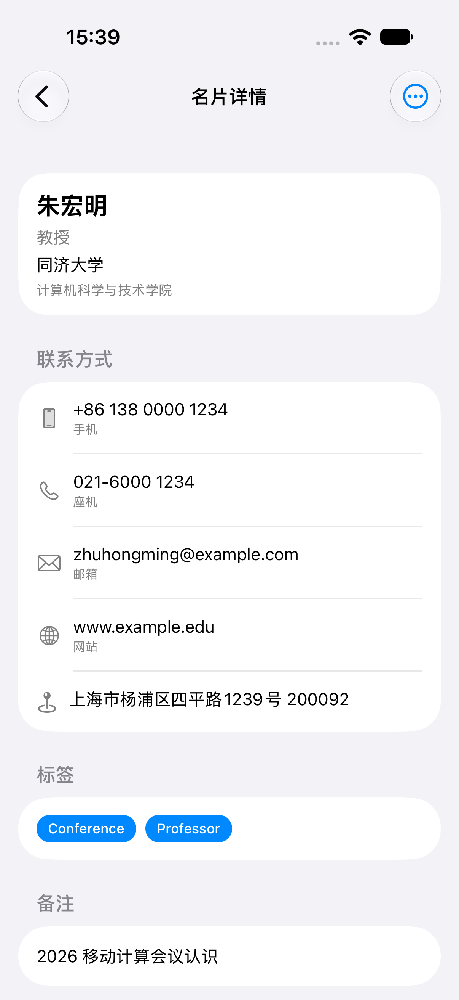

# 最终报告草稿（审查修复后）

## 实现范围

以 SwiftUI + Vision 实现名片数字化与联系人管理闭环：拍摄/导入、预览、边界检测/校正、OCR、规则解析、人工确认、保存、详情/编辑/搜索/标签/备注、重启保持、VCF/通讯录导出。

自写 Codable JSON/图片，无第三方 SPM 或云 OCR/LLM。识别结果必须人工确认；可选 recognition 快照保留原始识别与修改前字段，使最终联系人能追溯。

## 审查后的可靠性修复

保存失败不再伪装成功；删除先提交 JSON 再删图；未提交标签随草稿取消。识别工作移出主线程，并丢弃取消后的迟到结果。原图入口、编辑后导出、列表删除确认、混合电话标签、网址截断、数字邮箱和标签大小写均有回归。

实施与验证细节见 [审查修复记录](review-fixes-2026-10-28.md)。原始审查是修复前基线快照，不代表当前行为。

## 验证证据

- 规格/追溯：product-spec、acceptance、data-model、服务 API 与 ADR。
- 确定性：单元/集成、iPhone/iPad UI；T18 使用独立文件库真实 terminate/launch 核对修改、标签、备注与两张图。
- 概率性：保留原理想文本门槛；另统计完整集合和真实76张图，比较漏值、多值、缺失误填，见 [准确率报告](ocr-accuracy.md)。
- 字体：v2 按名片编号轮换，图片/GT/manifest/fixture 两次生成字节一致，业务 GT 未变。

不能把测试方法数量当成20条验收全部签收；也不能把理想文本100%说成图像准确率。系统 Vision 错字和无标签类型歧义仍如实计错。

## 界面截图

| 页面 | 截图 |
|---|---|
| 名片夹 |  |
| 预览 |  |
| 裁剪 |  |
| 确认 |  |
| 详情 |  |

## 结课前尚需签收

正版 CamCard 的参考环境、逐页行为/截图和同图识别对比；真机相机、权限、通讯录落库、实拍质量。外部清单见 `docs/testing/external-acceptance.md`，完成后才能定稿行为等价结论。
