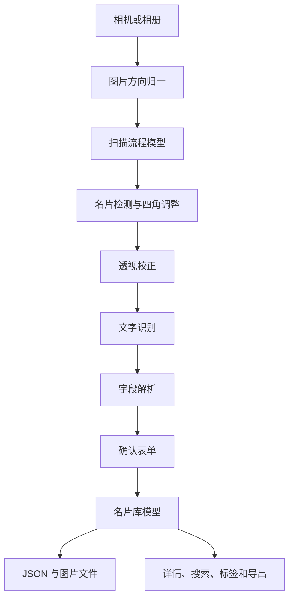
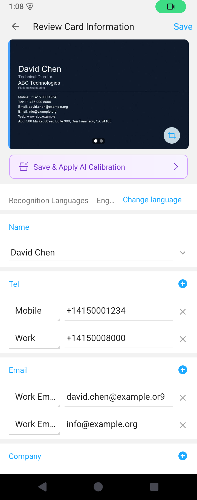
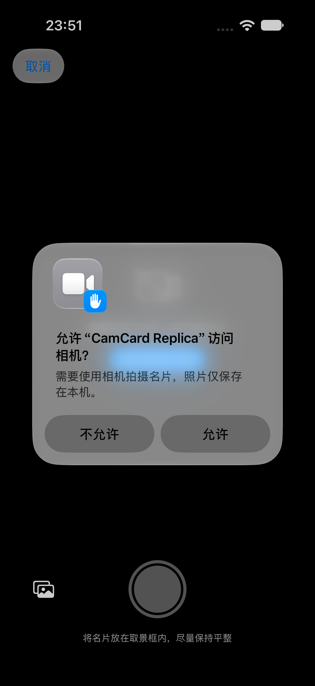
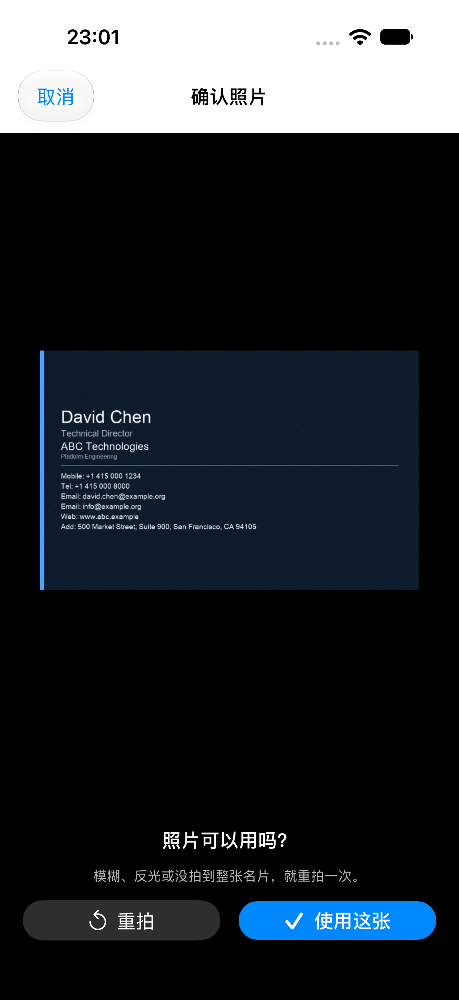
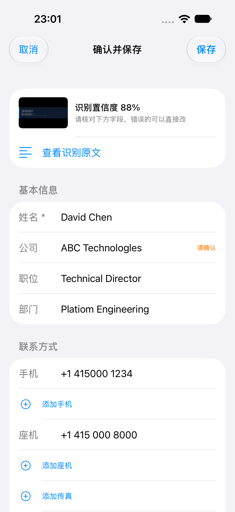
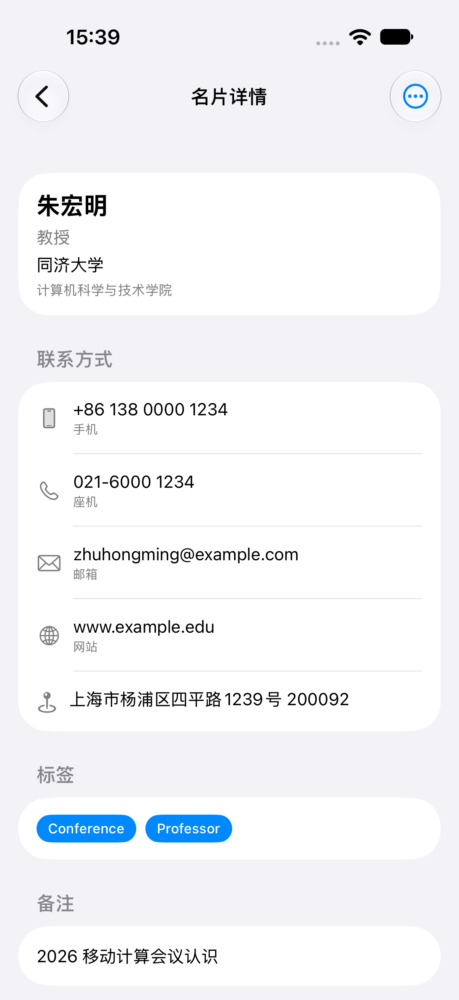

# CamCard 名片数字化与联系人管理

移动应用开发课程作业报告

2026 年 11 月

作者姓名、学号、课程与班级见随附的确认表。

## 1 项目与运行环境

这个作业复刻「名片全能王」里从扫描名片到管理联系人的一段完整流程。用户拍照或从相册导入一张名片，程序检测名片边界、做透视校正，用 Vision 识别文字，再把文字拆成姓名、公司、职位、部门、电话、邮箱、网站和地址。识别结果先进入确认页面，由用户修改和确认，保存之后才能在名片夹里看到。名片可以再次查看、编辑、搜索、添加标签、写备注和删除，也能导出成 vCard。界面用 SwiftUI 编写，识别使用 Apple Vision 和 Core Image，数据由自写的 Codable 编码写入 JSON 和图片文件。项目没有引入第三方依赖，也没有调用云端 OCR。

开发和验证在 macOS 27.0.1、Xcode 27.2、iOS SDK 27.2 上完成，默认测试设备是 iPhone 18 Pro 模拟器（iOS 27.0）。部署目标是 iOS 17.0，界面同时适配 iPhone 和 iPad。参考应用是官方 Android 版 CamCard 8.25.0.20260129，运行在 Android 15 / API 35 模拟器上，使用 Basic 模式，识别语言同时开启英语和简体中文。

关于一些开发过程中使用到的文档：产品行为按课程章节编号整理在 `docs/spec/product-spec.md`，验收场景与测试的对应关系在 `docs/spec/acceptance.md`，架构决策在 `docs/architecture/adr`，原始测量数据、截图和运行记录在 `docs/reports/evidence` 下面。

## 2 业务流程

用户打开应用先看到名片夹。名片夹为空时页面中央给出扫描入口；已经有名片时按修改时间从新到旧排列，每一行显示姓名、公司与职位、第一个电话号码和标签。点扫描进入相机，首次使用会弹出系统权限请求。拍到照片后先进入预览，用户可以重拍，也可以确认使用这张；确认之后进入裁剪页，四角默认由检测结果给出，用户仍然可以拖动调整。相册导入省掉拍摄和预览，图片加载完成后同样进入裁剪页，后面的检测、校正、识别、解析和保存走同一套代码。

识别阶段先得到每一行文字、位置和置信度，再由规则解析器给出字段候选。解析结果进入确认页面，字段以可编辑表单显示，电话和邮箱可以有多条。每个候选都带着自己的依据和分数，分数低的字段会提示用户核对。识别过程中没有归类的文字也保留下来，方便用户对照原图手工填写。姓名为空时保存按钮不可用；保存写入成功之后页面才关闭，列表立即出现新记录。写入失败时确认页面保留，用户看到失败原因，可以修改后重新提交。

扫描过程中可以取消。取消会让正在执行的操作标识失效，后台已经开始的识别结果返回时会被丢弃。相册加载也使用同一套失效检查，用户换图、重拍或退出之后，旧图片的结果不会覆盖新的草稿。确认页面里的标签改动和备注不会提前提交，只有保存成功才和其他字段一起写入。

保存后的名片在详情页显示全部字段和图片，原图与校正图可以切换查看。编辑使用同一个草稿结构，保存后更新原有记录和修改时间，不会产生第二张名片。搜索覆盖姓名、公司、职位、部门、电话、邮箱、网站、地址、备注和标签；标签提供独立的筛选条件，可以和搜索一起使用。删除需要确认，列表左滑和详情页两个入口都支持取消。导出使用已经保存的字段生成 VCF 文件，编辑之后导出的内容跟着更新。

## 3 规格依据与参考应用

课程 PDF 给出了功能边界、参考环境要求和 20 条参考测试场景。我把这些要求拆成带编号的产品规格，例如 7.2.2 对应拍摄后的预览和重拍，7.5.5 对应缺失字段不得凭空补全，12.1 对应保存必须写入磁盘。每个规格条款都能在 `docs/spec/acceptance.md` 里找到它对应的场景编号、测试方法和实现位置。这样的编号在改代码时很有用：修一个解析规则，能顺手看到它还牵连哪几条场景，不至于把附近的行为改坏。

参考应用使用官方 Android 版 CamCard 8.25.0.20260129，在 Android 15 / API 35 模拟器上以 Basic 模式运行，同时开启英语和简体中文，账号登录和首次启动协议由使用者完成。正式采集之前清空这次创建的测试联系人，名片夹保持为空；每次只向受控相册导入一张图片，核对原始文件与设备文件的 SHA-256，读取完整的确认表单后用 Retake 取消保存。网页端的录入、编辑、搜索、分组和备注单独记录操作过程。vCard 导出实际进入了会员页面，没有拿到文件。

课程要求从 UI、交互、状态、数据、异常和流程六个方面观察参考应用。UI 方面记录了页面结构、字段顺序和按钮位置：Android 确认页和网页管理页已经实际看过，iOS 版没有验证。交互方面观察了导入、保存、取消、删除、重试和搜索等操作，官网部分覆盖了录入、详情、编辑、搜索、分组和备注。状态方面记录了保存提示、Retake 之后回到哪一页，以及网页刷新后的内容。数据方面采集了 76 张同图名片的完整初始字段，包括多值电话、多个邮箱、组织信息和地址组件；会员导出没有拿到文件。异常方面只观察了正版的空识别结果和取消保存，权限拒绝和读写失败没有在正版上成套验证。流程方面走通了 Android 从导入到确认取消的路径和官网从录入到管理的路径，真实拍摄条件没有验证。

官方中文官网和 iPhone 帮助页在 10 月底归档，内容涉及扫描识别、信息校对、已保存记录的编辑、分组管理和保存到通讯录，资料日期和网页摘录保存在 `docs/reports/difference-analysis.md`。`docs/submission/reference-observations.csv` 记录 Android 与官网各自观察到的范围、限制和证据位置，`docs/submission/reference-ocr.csv` 记录 76 张图片的实际初始字段。没有验证的部分在这些文件里明确标注，不用推测补齐。

## 4 规格拆解与追溯

规格文档只描述用户能看到的行为，架构文档说明模块职责，测试给出具体输入和断言，证据目录保存运行结果。验收矩阵用 T 编号把这四类材料连起来。这样做的目的很实际：解析规则和界面状态互相影响，只改一个局部现象很容易在另一个场景留下回归，追溯表能让修改范围提前暴露。

举两个例子。7.5.5 要求名片上没有网站时输出空值，对应的场景是 T09，实现落在解析器的低置信过滤和每条规则的依据记录上。7.2.3 要求相册加载的旧结果不能覆盖新草稿，对应的是一组异步测试，分别控制旧成功、旧失败、重新拍摄、取消任务和替换选择五种返回顺序。前者靠字段反例和完整集合统计检查，后者靠流程模型的状态断言检查。

修改记录里比较有代表性的有三处。R18 处理邮箱和网址中的组织词：`contact01@example.com` 里的 `example` 带着机构词的样子，早期规则会把域名片段当成公司名，后来在识别组织字段时屏蔽已经提取出的邮箱和网址区间，同时保留公司名后面直接跟法律后缀的写法。R23 处理相册加载顺序，提交 b232f04 把图片加载也纳入操作标识检查，状态规则和识别任务保持一致。R24 处理读取失败，提交 b9b243b 区分「文件不存在」和「文件存在但读不出来」，读取失败时首页显示原因和重试入口，恢复之前不允许扫描。这三处都是先看到具体反例，再补回归测试，最后改规则；只堵住反例而把合法输入一起屏蔽的改法在评审里被否掉了。

识别证据的结构也是从一次失败里补出来的。最初的快照只保存最终字段，旧记录经过一次编解码就丢掉了 OCR 原文、逐行结果、解析依据、置信度和图片标识，六个断言同时失败。补上 `RecognitionSnapshot` 和对应的图片附件之后，同一个测试通过，完整评测的结果也保持一致。详细摘要见 `docs/reports/verification-2026-11-07.md`。

## 5 模块职责与协议设计

工程按职责分成几层：`Sources/Models` 放领域模型，`Sources/Services` 放识别、解析、导出和图片编解码，`Sources/Persistence` 放存储协议和文件实现，`Sources/Features` 放各个界面，`Sources/DesignSystem` 放主题和小控件，`Sources/Support` 放无障碍标识、测试配置和演示数据。界面通过装配好的 `AppServices` 访问系统服务；模型和流程依赖协议，测试可以替换成内存实现、固定图源或会注入错误的存储。



服务接口按输入输出和失败语义划分。`CardDetecting` 接收图片和方向，返回四边形或者没有检测结果，没有结果时允许整图继续。`ImageCorrecting` 接收图片和四角，返回校正后的图片，失败由流程决定回到裁剪还是提示重试。`TextRecognizing` 接收实际识别输入和方向，返回 OCR 结果，识别异常向调用者传播。`FieldParsing` 接收 OCR 结果，返回带值、置信度和依据的字段候选。`ContactExporting` 接收名片，返回 VCF 数据或通讯录写入结果。`CameraPermissionProviding` 把系统权限状态翻译成应用能理解的状态。`CardStore` 负责名片库和图片的读写，加载失败时抛出可以显示给用户的错误。

`AppServices.make` 是唯一的装配位置。生产配置创建系统服务；测试配置可以改权限状态、换存储实现、注入错误或者换成固定图源。固定图源只影响图片从哪里来，检测、Vision 识别和规则解析仍然走真实实现，这样 UI 测试能稳定跑，识别链路的代码也没有被测试替身绕开。

### 5.1 状态与并发

界面状态通过 `@Observable` 在主 actor 上发布。相机会话使用专门的队列启动和停止，避免阻塞界面。检测、透视校正、OCR 和字段解析放在后台任务里执行，结果返回时先检查操作标识。相册加载使用同一套机制。

取消任务的时候，底层识别调用可能已经开始了，没有办法从外部强行中断。这里的做法是让结果自己失效：操作标识一旦改变，返回的值和错误都被忽略。测试同时检查界面能及时响应取消，以及迟到的成功和失败都不会改动正在编辑的草稿。这条规则在实现里只有几行，但少了它，快速重拍或者换图就会出现上一张名片的内容。

### 5.2 设计决策

架构决策单独记在 `docs/architecture/adr` 目录。ADR-0001 记录 Vision 与 Core Image 的选型，ADR-0002 记录纯规则解析，ADR-0003 记录文件持久化，ADR-0004 记录协议边界与固定测试图源，ADR-0005 记录工程生成和提交格式，ADR-0006 记录识别快照、完整测量和证据规则。每份 ADR 都写了当时考虑过的替代做法和放弃原因，评审时不必重新推导。

## 6 领域模型、草稿与时间

`BusinessCard` 表示已经保存的名片，`id` 是 UUID，用于列表导航、更新和导出时隔离不同记录。字段包括姓名、公司、职位、部门、电话集合、邮箱集合、网站、地址、标签、备注、原图标识、校正图标识、识别原文、识别快照以及创建时间和修改时间。可选字段用 `String?`，空字符串在入库前统一转成 `nil`。

电话用 `PhoneNumber` 表示，包含 `kind` 和 `number`，`kind` 取 `mobile`、`office` 或 `fax`。同一张名片上，同一个号码可以同时出现在不同明确类型下，例如电话和传真共用一个号码；同一类型内按数字去重。邮箱使用字符串数组，保留全部值，顺序按识别出现的顺序。标签和备注属于管理信息，标签参与筛选，备注参与搜索。图片只保存标识，文件本身放在图片目录里。

`CardDraft` 是确认页面和详情编辑共用的可变结构。表单在草稿里增删电话和邮箱，保存时过滤空条目，再生成 `BusinessCard`。姓名是否为空由 `canSave` 表达，其他字段是否存在由实际内容和用户确认决定，解析器不替用户做「合理猜测」。标签的添加和删除也暂存在草稿里；取消表单会丢弃这些操作，保存时名片变更和标签变更一起提交。删除全库标签需要同时从其他名片上摘掉，提交前先构造候选库，保证不会只改一半。

`RecognitionSnapshot` 保存 OCR 结果和最初的解析结果。用户改了姓名或公司之后，最终字段更新，初始快照仍然保留第一次识别的原文、逐行结果和候选依据，方便事后判断错误来自识别还是来自规则。`RecognitionSnapshotTests` 覆盖人工修改、再次编辑、写入磁盘和重新读取之后的快照内容；旧版本 JSON 没有这个字段时仍然可以解码。

创建时间保存记录最初写入的时间，修改时间在每次提交时更新。列表按修改时间倒序排列，改过的名片会回到靠前的位置。时间由可注入的 `now` 提供，测试可以稳定断言排序和提交结果，不用等待真实时钟。

## 7 文件存储、提交顺序与恢复

名片库放在应用的 `Application Support/CamCardReplica` 目录下。`library.json` 保存结构化记录，`Images` 目录保存按 UUID 命名的 JPEG 文件。JSON 使用可读缩进、稳定的键排序和 ISO-8601 日期，出了问题可以直接打开文件看字段和图片引用。

```text
CamCardReplica/
  library.json
  Images/
    <original-image-id>.jpg
    <processed-image-id>.jpg
```

### 7.1 新增记录

新增名片时先为原图和校正图各生成一个标识，把两张图片写入文件，再构造带上图片引用的候选记录和候选库。`CardLibraryModel.commit` 调用 `CardStore.save`，写入成功之后才发布新的 `cards` 和 `tags`。任何一张图片或 JSON 写入失败都会把错误传回界面，新增路径负责清理这次已经写入的图片。

这个顺序决定了确认页面什么时候关闭：只有 JSON 提交成功，页面才关闭并回到列表。失败时用户留在表单里，可以继续检查内容、修改或者重新保存；内存里已经提交的库保持原样，不会出现界面上说保存成功、磁盘上却没有记录的情况。测试覆盖第二张图片写入失败、JSON 保存失败和失败后重试成功三种路径。

### 7.2 编辑、标签和删除

编辑时先构造候选数组，替换相同 `id` 的元素，更新修改时间，再走同一套提交。标签标准化会去掉首尾空白、合并大小写不同的同名标签、去重并排序。删除先提交剩余记录，再计算仍然被引用的图片集合，只删除已经没有人引用的文件。提交失败时页面保留，原记录不动。

图片文件和 JSON 分两次写入。进程如果在 JSON 已经提交、旧图片还没有清理的瞬间退出，可能留下没有引用的图片文件；已经提交的记录引用的图片不会丢。这个文件级边界写在 ADR-0003 里，测试用可以控制失败位置的存储实现覆盖了能测的部分，进程被强杀的情况只能靠启动时的完整性检查兜底。

### 7.3 读取失败

文件不存在时返回空库，这是新安装的正常状态。文件存在但无法解码时返回读取错误，不能当成空库处理，否则用户会看到名片夹突然变空，接着又写入一份新库，把旧数据覆盖掉。`CardLibraryModel` 把加载错误和操作错误分开，加载恢复之前拒绝提交候选库。首页显示失败原因和重试按钮，重试调用 `reload` 重新读取原文件，成功之后发布实际数据并清除错误。

测试覆盖读取失败、原文件保持、重新读取成功和恢复扫描入口四种情况。取消或者失败都不会自动创建空文件替换旧库，这一点看起来只是错误处理，实际关系到数据安全。

### 7.4 重启之后

T18 使用独立的 UUID 文件库运行：保存一张带修改、标签、备注和图片的名片，终止应用，重新启动，再打开同一条记录，检查姓名、公司、备注、标签以及原图和校正图。这个 UI 用例执行真实的终止和启动，文件库单元测试另外做完整的文件回读。模拟器上的证据已经齐了，真机路径由于没有设备，保留未验证状态。

## 8 相机、相册与外部图源

`CameraController` 封装 `AVCaptureSession`、`AVCapturePhotoOutput`、会话队列和照片代理。配置时先找后置广角设备，创建 `AVCaptureDeviceInput`，把输入和照片输出加入会话，再在专用队列上启动。拍照通过照片代理异步返回图像数据，后面的解码和流程切换由界面和模型完成，相机层不参与识别。

### 8.1 权限状态

`SystemCameraPermission` 把系统的相机权限翻译成应用自己的状态，只有已经授权时才允许按快门。首次请求、拒绝状态映射和界面禁用都有单元测试和注入式 UI 测试。模拟器上另外做了一组真实系统权限专项，分别覆盖已有授权、已有拒绝、首次弹窗选择允许和首次弹窗选择拒绝四种条件，四种都通过，并保存了系统弹窗和页面状态的截图。实际设备上从「设置」返回应用的行为没有验证，因为没有 iPhone。

相册使用系统 `PhotosPicker` 提供选择结果，图片加载放在异步入口完成。取消选择、空数据、损坏图片和加载错误都有明确处理。10 月下旬在模拟器上实际走过系统相册的选取和取消两条路径，留下了截图；这段流程没有用测试替身。

### 8.2 固定图源与 FauxCam

常规 UI 回归使用 `fixture-camera` 启动配置，图片从仓库自带的固定图源读取，方便稳定检查预览、裁剪和后面的表单。FauxCam 专项把 `fixture-camera` 设为 NO，使用真实的快门按钮和正常的 `AVCapturePhotoOutput` 回调取图。

FauxCam 1.1.0 从官方发布页下载，应用和对应命令行工具都核对了发布文件的 SHA-256。应用安装在用户的 Applications 目录，命令行工具放在用户目录的 `.local/bin`，工具本体和动态库留在本机，仓库只保存测试代码、复现命令、截图和日志。测试用 `TestData/cards/en-01.png` 作为输入，经本地帧服务进入模拟器，设置独立内存库，检查快门、照片预览、重拍、再次拍摄、裁剪、Vision 识别、姓名字段、OCR 原文和保存结果。整条专项在 18.967 秒内跑完。

专项运行和截图在 `docs/reports/fauxcam-validation-2026-11-07.md`，证据目录是 `docs/reports/evidence/fauxcam-2026-11-07`。这个工具自己提供视频授权状态，系统权限由另一组模拟器专项验证。使用者没有 iPhone，真实拍照的光照、反光和焦距条件保留未验证状态。

## 9 名片边界、坐标与透视处理

自动检测使用 `VNDetectRectanglesRequest`。配置把名片长边与短边的比例限制在 1.25 到 2.4，最小尺寸设为 0.15，角度容差设为 35 度，最多保留三个候选，置信度门槛依次尝试 0.75、0.55 和 0.35。门槛逐次降低是为了给斜拍和遮挡留一些余量，同时避免把桌面上的矩形当成名片。

Vision 的宽高比参数使用短边除以长边，所以传给请求的区间是 1/2.4 到 1/1.25。候选四边形先检查面积和角点坐标，再选面积最大的一个。检测失败返回没有结果，流程使用整图边界继续，用户也可以手动调整四角。

`Quad` 保存左上、右上、右下、左下四个角，坐标归一化到 0 到 1。面积由四个顶点计算，拖动后的坐标限制在图片范围内。测试覆盖宽卡、方形卡、坐标钳制、透视输入和单个角被遮挡的情况。

### 9.1 坐标系转换

Vision 的原点在左下角，界面和模型约定原点在左上角。检测适配层执行 `y = 1 - y`；透视校正把归一化坐标乘以图片宽高，再转换回 Core Image 使用的纵向坐标。四个角点按同一顺序传给 `CIPerspectiveCorrection`，顺序错了会得到镜像或者翻转的图像。

照片进入流程时先把 EXIF 方向应用到像素上，检测、校正和 OCR 处理的是同一方向和同一套坐标。图像方向测试检查旋转之后的宽高和像素位置，防止出现四角来自一个方向、图像使用另一个方向的情况。

### 9.2 整图与错误恢复

四边形等于整图边界时直接返回方向归一之后的输入。R25 的像素回归发现，即使透视变换在几何上保持整图，重采样和颜色处理仍会改变小字像素，因此整图路径保留原始解码像素。这个修复看起来只是省了一次变换，实际影响的是整图识别率。

透视处理失败时使用输入图继续识别；识别失败则返回裁剪页面并显示原因，用户可以重新调整四角或者重拍。合成照片里的透视、阴影和遮挡提供了固定回归输入，真实拍照条件由作者补充。

## 10 文字识别与证据结构

文字识别使用 `VNRecognizeTextRequest`，level 设为 accurate，语言是 zh-Hans 和 en-US，启用语言纠正，`minimumTextHeight` 设为 0.008。请求使用实际校正图或整图输入，`OCRResult` 同时记录图片尺寸和处理耗时。

### 10.1 逐行结果

每个 Vision 观察保存第一候选文字、置信度和矩形。矩形转换到左上角原点之后用于布局判断。`rawText` 按纵向位置排序，用换行拼接；解析器使用的 `readingOrderedLines` 会进一步把纵向位置接近的文字归到同一行，再按横向位置排序。

这个差别对两栏名片影响很大。保存原文时保留 Vision 的观察顺序，字段解析时则需要结合相邻行、字号线索和位置。OCR 原文里可能有重复标签或者字符误识别，后面的解析会做文本归一和分类，原始观察继续保留，不会因为解析而改写。

### 10.2 置信度的含义

Vision 的逐行置信度随候选文字保存。`ParsedValue` 的置信度来自规则评分，两者在数据结构里分开记录。界面上的低置信提示使用解析候选值，不能从单个平均值判断整张名片是否全部正确。

这一批数据里有邮箱字符错误和电话类型歧义。即使某些字段评分很高，用户仍然需要核对原图和字段。报告用逐图 GT 测量记录实际错误，界面用人工确认控制最终保存值，两道检查都在。

### 10.3 原始证据附件

批量测试对每张图片记录源文件哈希、处理后的图片文件名、处理图哈希、检测四角、处理方式、OCR 结果、初始解析结果和字段比较。实际识别输入编码成 PNG，作为 XCTest 的永久附件保存，这样换了机器或者换了 Vision 版本之后仍然能复查当时到底看到了什么。

导出工具从同一个 xcresult 里读取图片附件，按 SHA-256 匹配记录，校验源图与 GT，再导出原文、初始字段、图片和统计。`docs/reports/evidence/ocr-2026-11-07/run.json` 保存日期、设备、结果包、识别配置、GT 哈希和测量时 Swift 源文件的哈希。具体文件说明在 `docs/reports/evidence/ocr-2026-11-07/README.md`。

## 11 字段解析规则与证据评分

`HeuristicFieldParser` 接收 OCR 结果，输出 `ParsedCard`。它负责文本归一、阅读顺序、联系方式提取、姓名与组织字段评分、地址证据和低置信过滤。每个候选保存实际值、置信度和依据，界面可以展示规则为什么选中它，出错时也能追到是哪条证据被误读。

### 11.1 文本归一与联系方式保护

`TextNormalizer` 统一常见标点、标签写法和空白，处理中英文混排。邮箱和网址用正则提取；其他分类规则在检查文字时屏蔽已经识别出的联系方式区间，避免域名里的公司词、职位词或者部门词参与评分。

电话号码扫描同样屏蔽邮箱和网址占用的范围，防止邮箱用户名里的长数字被当成电话。地址规则排除联系方式里的数字和地址词，避免电话、邮箱和网址构成虚假的邮编或街道证据。这三条保护规则分别是从具体的误填案例里补出来的，测试里保留了反例。

### 11.2 姓名、公司和职位

姓名候选结合文字位置、字号线索、称谓和其他字段特征。公司规则使用机构词表和法律后缀；职位规则先扣除机构等冲突证据，要求净分为正，没有合格候选时保留空值，防止从负分候选里硬选一个结果出来。

部门字段使用部门词表和组织上下文。原文里有一行文字，规则未必能把它正确分到部门；department 测量里保留了漏提取的情况，用户可以通过未归类文字和原图手工修正。规则宁可漏掉一个字段，也不从没有证据的文字里造一个值，这是 T09 的同一个原则。

### 11.3 电话标签与格式

`PhoneClassifier` 识别 Mobile、Tel、Fax 及对应的中文标签。同一行有多个号码时，根据各自的位置关联最近的标签。明确标签的候选评分为 0.96。没有标签时按号码格式给候选：中国手机格式评分 0.88，区号样式座机评分 0.82，部分服务号码评分 0.78，国际或其他格式使用更低的评分。

| 输入依据 | 现有处理 | 保留的风险 |
|---|---|---|
| 明确 Mobile / 手机标签 | 分类为 mobile | OCR 可能识别错标签或号码 |
| 明确 Tel / 电话标签 | 分类为 office | 标签位置可能受排版影响 |
| 明确 Fax / 传真标签 | 分类为 fax | 标签缺失会削弱依据 |
| 同号、不同明确类型 | 各自保留 | 导出时需要保持两个标签 |
| 无标签、区号格式 | 给出 office 候选 | 传真也可能使用同类格式 |
| 无标签、国际格式 | 给出较低置信候选 | 手机与办公电话存在歧义 |

`TestData/cards/zh-06.png` 的号码被分类为座机，GT 把它定义为传真。号码格式本身无法提供传真所需的全部证据，完整集合测量继续记为错误，界面允许人工修改类型。这条限制在测试里用期望失败标出，没有用 GT 或者号码顺序硬编码来「修」成正确。

### 11.4 网站、地址与缺失字段

网站候选需要 www 或 http(s) 前缀，或者明确的网站标签。无法确认的裸域名留在未归类文字里。这条规则来自一次回归：字体换掉之后邮箱里的 `@` 被 OCR 丢失，剩下的裸域名被误判成网站，于是要求网站必须有更强的证据。代价是无标签、无前缀的真实网址需要人工补入，这个取舍符合不虚构字段的产品规则。

地址可以依据非空的 Address、Add、地址标签、门牌号与街道词、行政区和邮编等证据。测试包含短地址、空标签、孤立街道词、联系方式中的数字和复合街道后缀。低于保留阈值的候选被过滤，界面针对保留下来的低置信字段显示核对提示。缺失字段测试单独检查没有网站时的输出，完整测量还统计其他字段的缺失误填。

## 12 人工确认、草稿取消与保存错误

`ReviewView` 把识别输出转成 `CardDraft`，提供字段表单、低置信提示、OCR 原文和未归类文字。用户可以添加、修改和删除号码或邮箱条目，选择电话号码类型。标签和备注随草稿保留，确认保存时一起提交。

### 12.1 用户核对的内容

用户需要核对三类东西：字符、字段类别和多值完整性。`contact01` 与 `contactol` 的差异属于字符，`office` 与 `fax` 属于类别，漏掉第二个邮箱属于集合完整性。这些问题在界面上用对应的文本或者类型控件修改，最终保存的内容来自确认之后的草稿，解析器的初始结果不会被直接写进名片。

OCR 原文弹层显示初始解析结果和依据，并保留逐行置信度。用户能看出规则为什么选了某个字段，再结合原图决定改不改。确认页顶部的置信度是对这次候选评分的汇集，整张名片是否完整仍然要靠逐字段核对和测试检查。

### 12.2 空值与修改

空白输入在生成保存记录时归一为空值，空的号码和邮箱不保留。姓名要求非空，这个条件同时用在保存按钮和模型保存入口，绕过界面直接调用模型也保存不了空姓名。OCR 完全没有文字时允许进入空表单，用户填写姓名之后可以继续保存。

标签的新增和全库标签删除记录在草稿里。确认页面或者详情编辑取消之后，未提交的标签保持丢弃状态。标签大小写归一化、删除一个标签影响其他名片等逻辑由库模型单元测试检查。

### 12.3 错误反馈

保存失败时页面保留字段，显示错误并允许重新操作。存储异常向模型和界面传播，提交成功之后才关闭流程。测试用会失败的存储实现检查原库、候选记录和图片清理；UI 测试检查保存失败的提示和表单是否留下。

后台识别失败时返回裁剪页，用户可以重新调整或者重拍。取消之后迟到的错误和成功结果都要经过操作标识检查。相册加载失败和识别失败分别保留原因，避免旧任务的错误覆盖正在处理的新图片。

作者实际修改的值、不同字段的修改数量、编辑动作次数和附件保存在 `docs/submission/manual-corrections.csv`，这部分由作者本人填写。

## 13 名片列表、检索与标签管理

`CardLibraryModel` 提供按查询和标签过滤之后的记录，按修改时间倒序排列。列表通过记录 `id` 进入详情，新增或者编辑提交之后由观察状态刷新。读取失败时显示独立的错误页面，恢复之前禁用扫描入口。

### 13.1 搜索内容与数字归一

`BusinessCard.searchableText` 包含姓名、公司、职位、部门、地址、备注、网站、号码、邮箱和标签，合并之后转成小写。查询会去掉首尾空白，空查询返回全部记录。

纯数字和加号形式的查询先提取数字，再在电话的数字部分做包含匹配。所以保存成带空格或者连字符的号码，可以用连续数字查出来。其他文本用归一之后的字符串包含关系，测试覆盖姓名、公司、职位、电话和邮箱。

### 13.2 标签语义

标签有名称和一个用于比较的大小写归一值。创建时去掉首尾空白，已有同名标签时使用已有的规范名称；给名片附加标签之后可以在列表里按标签筛选。删除全库标签会把它从标签集合和所有记录里移除。

筛选和搜索可以组合，先检查标签，再检查查询。测试覆盖标签创建、附加、筛选、大小写和删除后重新读取。确认或者编辑期间的标签变化暂存在草稿里，保存时一次提交，取消时不会留下半套改动。

### 13.3 详情与外部入口

详情显示保存的字段和图片。点图片打开查看器，可以在原图和校正图之间切换；电话号码、邮箱和网站提供系统 URL 入口。删除有确认步骤，列表左滑和详情页都支持取消。

备注可以记录会议、来源和后续联系信息，随记录持久化并参与搜索。备注和 OCR 原文分开保存，用户写备注不会覆盖识别证据。详情里已经保存的字段也是导出数据的来源。

## 14 联系人映射、VCF 与导出

`ContactsExporter` 把 `BusinessCard` 转成 `CNMutableContact`，再用 `CNContactVCardSerialization` 生成 VCF。保存到系统通讯录时请求授权，成功后用 `CNSaveRequest` 写入；拒绝授权或者编码失败都通过错误返回，不会静默成功。

| 名片内容 | 联系人字段或标签 | 处理规则 |
|---|---|---|
| 姓名 | givenName / familyName | 拉丁姓名使用最后一部分作为 familyName；含中文时保留完整姓名 |
| 公司 | organizationName | 空值转换为空字符串 |
| 职位 | jobTitle | 保留已保存的值 |
| 部门 | departmentName | 按字段映射 |
| 手机 | mobile 标签 | 保留每个号码 |
| 座机 | work 标签 | 保留每个号码 |
| 传真 | workFax 标签 | 同号不同类型继续分别导出 |
| 邮箱 | work 标签邮箱集合 | 保留全部邮箱 |
| 网站 | URL 地址 | 必要时补上链接协议，便于打开 |
| 地址 | postalAddresses.street | 整体保存地址字符串 |
| 备注 | note | 非空时赋值 |

`VCardDocument` 是已经保存名片的 `Transferable` 值，分享时生成文件。文件位置用 UUID 命名，编辑之后导出使用新的值，同名联系人的文件互相独立。`VCardDocumentTests` 修改公司、职位、电话、邮箱、地址和网站之后再导出，重新解析生成的 VCF 并逐字段断言；另一个测试保留编辑前的文件，检查旧文件内容和新记录之间的关系，还检查同名名片的导出路径和内容。`ContactsExporterTests` 检查电话号码标签、中文姓名、拉丁姓名和全部字段映射。

课程允许使用系统通讯录或者 VCF。这次提交有 VCF 的自动化证据，系统通讯录的实际授权、拒绝和写入联系人列表的人工结果保留未验证状态。作者可以按实际导出方式在最终确认表里填写。

## 15 测试分层与验收记录

测试分三层。单元测试覆盖模型、存储、解析规则、图片处理、权限映射、快照和导出；集成测试跑理想文本解析和全部 76 张图片的完整识别链路；UI 测试用 XCUITest 检查用户操作和页面状态。另有 Python 检查验证语料字体、构建路径、OCR 证据导出、正版采集读取和提交包拒绝条件。

| 类别 | 方法数量 | 内容 |
|---|---:|---|
| 单元测试 | 102 | 模型、库、规则、图片、权限、快照与导出 |
| 集成测量 | 7 | 理想文本、九个 fixture 与全部图片 |
| UI 定义 | 27 | 24 个常规功能方法、截图方法、FauxCam 专项与系统权限专项 |
| Python 检查 | 30 | 工具检查 3 项，OCR 证据 5 项，正版界面、比较与打包 22 项 |

### 15.1 本地运行结果

`make verify` 在本机通过，构建成功，109 个单元和集成方法，0 个非预期失败。`make bench` 通过 7 个评测方法，76 个图片输入全部产生识别记录。完整 iPhone UI 跑过 24 个功能方法，另有 1 个截图方法默认跳过。FauxCam 专项通过 1 个方法，正常快门、重拍、识别、原文和保存全部走通，耗时 18.967 秒。系统权限专项在未加载 FauxCam 的条件下分别执行四种权限状态，全部通过，并保存了原生系统弹窗截图。Python 工具检查 3 项通过，OCR 证据检查 5 项通过，正版界面、比较和打包检查 22 项通过。`make audit` 检查文档路径、`make` 子命令、测试方法名和统计数字，报告这轮修改之后没有不一致。

FauxCam 方法通过配置显式启用，默认测试不加载外部工具；截图方法同样需要显式开启。常规 UI 和新增专项分开保存运行结果，方法数量写在各自的日志里。无标签电话号码的已知歧义保留 `XCTExpectFailure`，完整集合和误填统计继续把它算作错误，没有用期望失败来篡改准确率。iPad 布局沿用 10 月下旬的历史运行结果，iOS 27 上的最后一次交互调整没有在 iPad 上复验。远端 CI 配置为 Linux 文档审计和证据工具检查，仓库里没有保存 CI 运行结果；Xcode 构建、单元测试和 UI 测试都在本地执行，结果单独保存。

### 15.2 T01–T20 的覆盖情况

课程参考套件有 20 条场景，仓库里每条都有对应的自动化检查或者人工记录，但证据强度不一样。

首次启动和扫描入口对应 T01 和 T02：名片夹为空时显示空状态和扫描按钮，已有记录时显示列表。相机权限对应 T03，状态映射和拒绝注入有单元测试，模拟器上还实际操作过系统弹窗的允许和拒绝。拍摄对应 T04，固定图源回归和 FauxCam 正常快门分别覆盖流程和真实回调。相册导入对应 T05，系统相册的选取和取消在模拟器上手工走过并留了截图；导入之后进入裁剪有单元测试，识别到确认沿用拍摄路径的自动化检查。

边界检测对应 T06，倾斜、遮挡和坐标钳制都有测试，裁剪页的重拍有 UI 测试；四角拖拽只有手工检查。OCR 对应 T07，76 个输入全部保存了原始输出。字段分类对应 T08，完整集合测量、字段反例和官方 Android 的同图比较一起检查。缺失网站对应 T09，专项测试和缺失输入误填统计都在。多号码对应 T10，明确标签和同号不同类型的正例通过，无标签号码的类型错误继续计分。人工修改和保存对应 T11、T12，修改后保存的 UI 流程通过，作者本人的实际修改案例还保留填写位置。

详情、编辑、搜索、标签和删除对应 T13 到 T17：详情字段和原图切换、编辑后更新、查询匹配、标签筛选、删除确认与取消都有 UI 测试，搜索和标签规则另有领域模型单元测试。重启保持对应 T18，模拟器上执行了真实的终止和启动，文件库另有完整回读。导出对应 T19，VCF 的完整字段反序列化和编辑后最新值都有测试；系统通讯录的真实写入没有在设备上验证。异常路径对应 T20，取消、空识别结果、识别失败、读取失败和保存失败都有注入测试。

每条场景的规格编号、测试方法名和实现位置在 `docs/spec/acceptance.md`。正版六个方面的观察范围在 `docs/reports/difference-analysis.md`，平台差异和未验证部分分别保留，没有把「自动化测试通过」写成「真机验收通过」。

## 16 合成语料、GT 与样本分布

语料由 `Scripts/generate_test_cards.py` 生成，随机种子固定为 20261027。v2 保留 50 张合成名片的业务字段，用不同字体家族生成图像，并同步生成九个 App fixture。GT、manifest 和原始图片一起保存，评测和 UI 测试用的是同一份语料。

在 50 张平面图像之外，生成器还固定产出透视和桌面背景、边缘遮挡以及照片遮挡三种变体，合计 76 个图像输入。边缘遮挡覆盖名片页边距，检测测试检查轮廓被部分遮挡之后还能不能找到名片；照片变体使用固定的合成变换和纹理，保证每次生成的结果一致。

| 图片类别 | 数量 | 构成 |
|---|---:|---|
| flat | 50 | 清晰平面名片 |
| photo | 12 | 透视、轻微旋转、桌面和阴影 |
| occluded | 10 | 名片边缘部分遮挡 |
| occluded-photo | 4 | 照片变体与边缘遮挡结合 |

| 统计维度 | 类别 | 图片数量 |
|---|---|---:|
| 语言 | zh | 26 |
| 语言 | en | 21 |
| 语言 | bilingual | 29 |
| 版式 | classic | 19 |
| 版式 | centered | 20 |
| 版式 | two-column | 16 |
| 版式 | vertical | 12 |
| 版式 | minimal | 9 |
| 电话标签 | 有标签 | 56 |
| 电话标签 | 无标签 | 20 |

同一张名片可能对应多张图片，变体之间共享业务 GT。字段指标以图像为计分单位，所以图像总数是分母。报告另外提供 flat 组统计，方便看基础合成名片的结果。

### 16.1 GT 与缺失信息

每条 GT 包含图片文件名、语言、版式、字体、标签条件、实际字段和缺失字段说明。字段里的多个号码带类型，多个邮箱保留全部值。评测加载全部图片并核对文件集合，少一张图片就会报错，防止漏掉样本之后继续算出一个好看的数字。

名片使用虚构姓名、公司、`.example` 域名和固定测试号码，没有真实个人信息。原始图片保持脚本生成的结果，测试和文档修改过程中没有手工改过语料图片。生成器的字体选择和文本边界由 Python 工具检查验证。

### 16.2 可复现条件

重建语料需要 Pillow、NumPy 和指定字体。字体缺失时生成器直接报错，`font_file` 记录实际使用的字体来源。环境和字体变化会影响像素和识别输出，所以语料版本和测试环境随报告一起保存。

这轮证据使用现有语料和 GT，没有重新生成图片。实际识别输入是当次检测和校正之后的 PNG，另有对应哈希；原图、处理图、OCR 结果和字段比较可以用同一个文件名关联起来。

## 17 计分方式与字段级结果

完整集合比较对每类字段的全部值计分。值去掉首尾空白并忽略大小写，电话号码的内部格式保留。集合里漏掉第二个邮箱或者多出一个号码，这个字段整项算错。空字符串和空值都表示缺失。

### 17.1 三类测量输入

第一类是理想文本首值门槛：把 GT 拼成理想文字，只比较第一个邮箱和每类第一个号码。它保留的是历史解析回归要求，不表示多值完整或者 OCR 正确。第二类是理想文本完整集合：输入仍然是 GT 拼成的文字，但比较全部号码、邮箱和可选字段，能够暴露漏值、多值和缺失误填。第三类是实际图像完整集合：图片经过检测、校正、Vision 和解析，再逐字段对 GT，检查从图像到字段的完整结果。

理想文本首值结果里，name、company、jobTitle、email、website、address 各为 50/50，mobile 为 50/50，office 为 49/50，fax 为 45/50。完整集合文本结果里，department 为 43/50，mobile 为 46/50，office 为 49/50，fax 为 45/50。历史门槛没有下调，缺失网站专项的 15/15 也保持。

### 17.2 图像到字段的完整集合准确率

「全部正确」包含字段原本缺失且输出为空的情况；「已印字段正确」只统计 GT 非空的图片；缺失误填只使用原本没有该字段的输入作分母。

| 字段 | 全部正确 | 准确率 | 已印字段正确 | 缺失误填 | 漏值 | 多值 |
|---|---:|---:|---:|---:|---:|---:|
| 姓名 | 74/76 | 97.4% | 74/76 | 0/0 | 2 | 2 |
| 公司 | 72/76 | 94.7% | 72/76 | 0/0 | 4 | 4 |
| 职位 | 70/76 | 92.1% | 70/76 | 0/0 | 6 | 6 |
| 部门 | 63/76 | 82.9% | 37/50 | 0/26 | 13 | 2 |
| 邮箱集合 | 47/76 | 61.8% | 47/76 | 0/0 | 31 | 27 |
| 网站 | 66/76 | 86.8% | 46/56 | 0/20 | 10 | 10 |
| 地址 | 44/76 | 57.9% | 25/57 | 0/19 | 32 | 32 |
| 手机集合 | 69/76 | 90.8% | 69/76 | 0/0 | 1 | 7 |
| 座机集合 | 72/76 | 94.7% | 28/31 | 1/45 | 3 | 4 |
| 传真集合 | 69/76 | 90.8% | 10/17 | 0/59 | 7 | 0 |

姓名在全部图片中正确 74 次，邮箱集合正确 47 次，地址正确 44 次。地址和邮箱的错误集中在字符识别和格式差异上，需要回到原文和初始解析里逐条看。座机缺失时有 1/45 误填，缺失网站有 0/20 误填。

### 17.3 值级精确率、召回率与 F1

值级统计把每个实际联系方式或者字段值单独计分。TP 是期望值数量减去漏值，FP 是多值数量，FN 是漏值数量；Precision 为 TP/(TP+FP)，Recall 为 TP/(TP+FN)，F1 为 2TP/(2TP+FP+FN)。这些数字和完整集合使用同一套归一与匹配规则。

| 字段 | TP | FP | FN | Precision | Recall | F1 |
|---|---:|---:|---:|---:|---:|---:|
| 姓名 | 74 | 2 | 2 | 97.4% | 97.4% | 97.4% |
| 公司 | 72 | 4 | 4 | 94.7% | 94.7% | 94.7% |
| 职位 | 70 | 6 | 6 | 92.1% | 92.1% | 92.1% |
| 部门 | 37 | 2 | 13 | 94.9% | 74.0% | 83.1% |
| 邮箱集合 | 53 | 27 | 31 | 66.2% | 63.1% | 64.6% |
| 网站 | 46 | 10 | 10 | 82.1% | 82.1% | 82.1% |
| 地址 | 25 | 32 | 32 | 43.9% | 43.9% | 43.9% |
| 手机集合 | 75 | 7 | 1 | 91.5% | 98.7% | 94.9% |
| 座机集合 | 28 | 4 | 3 | 87.5% | 90.3% | 88.9% |
| 传真集合 | 10 | 0 | 7 | 100.0% | 58.8% | 74.1% |

完整集合指标回答「这张名片的这个字段是否全部正确」，值级指标回答「具体值有没有漏或者多」。在多邮箱、多电话的条件下，两种计分单位差别很大，报告把两类结果都保留，原始比较也可以逐图复查。

### 17.4 按输入条件切分

| 图片组 | 姓名 | 公司 | 职位 | 邮箱集合 | 网站 | 地址 |
|---|---:|---:|---:|---:|---:|---:|
| flat | 49/50 | 47/50 | 47/50 | 32/50 | 47/50 | 32/50 |
| photo | 11/12 | 12/12 | 11/12 | 8/12 | 9/12 | 4/12 |
| occluded | 10/10 | 9/10 | 9/10 | 6/10 | 8/10 | 5/10 |
| occluded-photo | 4/4 | 4/4 | 3/4 | 1/4 | 2/4 | 3/4 |

| 语言 | 姓名 | 公司 | 职位 | 邮箱集合 | 网站 | 地址 |
|---|---:|---:|---:|---:|---:|---:|
| zh | 26/26 | 26/26 | 26/26 | 13/26 | 17/26 | 16/26 |
| en | 20/21 | 20/21 | 20/21 | 16/21 | 21/21 | 13/21 |
| bilingual | 28/29 | 26/29 | 24/29 | 18/29 | 28/29 | 15/29 |

全部字体、版式、电话标签、语言和图片种类的统计在 `docs/reports/evidence/ocr-2026-11-07/metrics.csv`。合成图像的分布是固定的，正版 Android 对相同输入的结果在下一节，真实拍摄质量没有验证。

### 17.5 正版 Android 的 76 张同图结果

比较双方使用固定集合中的同一份原始文件，原图 SHA-256 逐项一致。本项目使用已有的 Vision 全链路记录，正版使用 Android 8.25.0.20260129 的 Basic 初始字段，英语和简体中文同时启用。正式采集期间名片夹为空，每张读取之后取消保存，操作者没有修改字段。

| 统计方式 | 实现 | 全部字段完整集合正确 | 已印字段正确 | 缺失字段误填 | 值 F1 |
|---|---|---:|---:|---:|---:|
| 严格统计 | 本项目 | 646/760（85.0%） | 478/591（80.9%） | 1/169 | 82.8% |
| 严格统计 | 正版 Basic | 350/760（46.1%） | 202/591（34.2%） | 21/169 | 40.4% |
| 内容统计 | 本项目 | 672/760（88.4%） | 504/591（85.3%） | 1/169 | 87.2% |
| 内容统计 | 正版 Basic | 462/760（60.8%） | 314/591（53.1%） | 21/169 | 60.9% |

严格统计忽略大小写和首尾空白；内容统计额外统一电话格式、网站协议与根路径末尾斜线，并按地址组件语义排列之后去掉空白和逗号。原始电话、邮箱、全部组织字段和地址组件保持保留。错误字符、重复值和空结果都参与计分。两种统计同时展示，格式表示对数字的影响可以直接看出来。

完整同图报告在 `docs/reports/reference-comparison-2026-11-08.md`，里面有十类字段、语言、图片种类、整张正确与空结果的统计；逐图证据在 `docs/reports/evidence/reference-2026-11-08`，保存每张选择图片、完整表单截图、XML 和实际字段。比较工具重新读取原始 XML，并核对记录、输入、哈希和统计。正版可能把双语姓名拆到 Name 和 Nickname 两个控件，姓名按 Name 计分，Nickname 单独保留；组织信息也可能拆成多组。这些字段表示差异会影响完全匹配。这份准确率限定在合成集合、Basic 模式和实际版本上，`collectionSeconds` 包含导入、等待、滚动和截图，不能直接当作 OCR 算法耗时。

## 18 错误案例与定位依据

这些案例都来自同一次测量，使用的是同一份 GT、同一张实际识别输入、同一份 OCR 原文和初始字段。如果原文里已经出现字符差异，问题可以定位到识别结果；如果原文里有期望文字、字段结果仍然为空或者分类错误，就继续检查提取规则和 evidence。逐图原始记录在 `docs/reports/evidence/ocr-2026-11-07`，每个案例只列最直接的证据。

### 18.1 邮箱里的数字与近形字符：zh-01.png

GT 是 `["contact01@example.com"]`，初始结果是 `["contactol@example.com"]`，漏值 1，多值 1。

`TestData/cards/zh-01.png` 的原文是：

```text
朱宏明
教授
同济大学
计算机科学与技术学院
手机：+86 138 0000 1234
电话：021-6000 1234
传真：021-6000 1235
Email: contactol@example.com
Web: www.example0l.com
Add：上海市杨浦区四平路1239号 200092
```

原文里的邮箱写成 `contactol`，GT 是 `contact01`，差的是 `o`/`0`、`l`/`1` 一类的近形字符；同一张图上的网站也把 `01` 写成了 `0l`。邮箱正则接受这个字符串，规则没有别的手段知道它应该是数字。用户核对时需要把 `contactol` 改回 `contact01`，网站也要跟着改。这条案例对应的识别输入是 `docs/reports/evidence/ocr-2026-11-07/images/processed-zh-01.png`，初始解析依据是 `docs/reports/evidence/ocr-2026-11-07/parsed/zh-01.png.json`。

### 18.2 公司名称中的字符变化：en-01.png

GT 是 `["ABC Technologies"]`，初始结果是 `["ABC Technologles"]`，漏值 1，多值 1。

```text
David Chen
Technical Director
ABC Technologles
Platform Engineering
Mobile： +1 415 000 1234
Tel： +1415 000 8000
Email: david.chen@example.org
Email: info@example.org
Web:www.abc.example
Add: 500 Market Street, Suite 900, San Francisco, CA 94105
```

原文里的公司名是 `Technologles`，GT 是 `Technologies`，差一个近形字母，公司规则仍然把这一行识别成公司，但值不对。手机、邮箱和地址在这个案例里是对的，错误只落在公司字段。逐图证据在 `docs/reports/evidence/ocr-2026-11-07/parsed/en-01.png.json`。

### 18.3 照片变体中的姓名字符：en-03-photo.jpg

GT 是 `["Michael O'Brian"]`，初始结果是 `["Michae1 o'Brian"]`，漏值 1，多值 1。

```text
Michae1 o'Brian
VP Sales
Bright Harbor Logistics
G1obal Accounts
Mobile: Mobile： +44 20 0000 9012
Te1： +49 30 00006000
Tel：
Emai1:Emai1:michael.obrian@example.org
Web: www.bright.example
Web：
Add: Friedrichstrasse 88,10117 Berlin, Germany
Add：
EN
```

这张是照片变体，带有透视、桌面背景和阴影。姓名原文是 `Michae1 o'Brian`，GT 是 `Michael O'Brian`，差的是 `1`/`l` 一类的近形字符；原文里还有 `G1obal`、`Te1`、`Emai1` 等同类差异。姓名候选选对了行，值仍然是错的。邮箱值在原文里完整，只是标签被读错，所以字段结果正确。证据在 `docs/reports/evidence/ocr-2026-11-07/images/processed-en-03-photo.png` 和 `docs/reports/evidence/ocr-2026-11-07/parsed/en-03-photo.jpg.json`。

### 18.4 无标签传真分类：zh-06.png

GT 的传真字段是 `["0755-2000 9013"]`，初始结果为空，漏值 1。

```text
刘晓峰
合伙人
海通律师事务所
知识产权
+86 188 0000 2211
0755-2000 9013
contact06@example.com
www.example06.com
```

原文保留了这个号码，但名片上没有类型标签。号码格式规则把 0755 开头的号码判成座机，给了 office 候选，所以传真字段为空，座机字段多出一个值。GT 把它定义为传真，格式本身无法提供这个类型所需的全部证据。完整集合测量继续把这项算错，界面允许用户改成传真。这条限制写在 `docs/reports/ocr-accuracy.md` 的已知限制里。

### 18.5 地址内部空白：zh-02.png

GT 是 `["北京市海淀区中关村大街1号 100080"]`，初始结果是 `["北京市海淀区中关村大街1号100080"]`，漏值 1，多值 1。

```text
李静
技术总监
华远科技股份有限公司
研发中心
手机：+86 139 0000 5678
Email: contacto2@example.com
Web:www.example02.com
Add：北京市海淀区中关村大街1号100080
```

门牌号和邮编之间的空格在原文里就没有了。地址规则提取出来的内容完整，只是空格和 GT 不一致，匹配时保留内部格式，所以这一项算错。报告没有为了这个案例放宽整个地址匹配规则，因为放宽之后会把真正缺空格的地址和带空格的地址混在一起，影响其他字段的统计。原文和比较数组里同时保存这一差异。

### 18.6 部门字段漏提取：zh-03.png

GT 的部门是 `["运营管理部"]`，初始结果为空，漏值 1。

```text
王建国
副总经理
东方物流集团
运营管理部
手机：
+86137 00009012
contact03@example.com
Emal：
www.example03.com
W'cb：
ZH
```

部门文字在原文里出现了，但它没有标签，上下文的组织特征也不够强，部门规则没有给出候选。姓名、公司和职位在这个案例里是对的，漏掉的只有部门。用户可以在确认页的未归类文字里看到这一行，手工补进部门字段。这条漏值保留在统计里，没有用 GT 提示规则去「补齐」。

### 18.7 职位字段错误：en-04.png

GT 是 `["Product Manager"]`，初始结果是 `["Proauct Manager"]`，漏值 1，多值 1。

```text
Sarah Kim
Proauct Manager
Lumen Health Systems
Clinical Products
Mobile： +49 30 0000 3456
Email: sarah.kim@example.org
Web: www.lumen.example
```

原文里的职位是 `Proauct`，GT 是 `Product`，差一个近形字母，职位规则仍然选对了行，值不对。这个字段的置信度不低，说明单看规则分数发现不了字符错误，用户核对原图这一步不能省。

### 18.8 多邮箱及识别完整性：bi-11.png

GT 是 `["biz11@example.com", "sales11@example.net"]`，初始结果是 `["1@example.com", "salesl1@example.net"]`，漏值 2，多值 2。

```text
朱宏明 Zhu Hongming
教授 Professor
同济大学 Tongii University
计算机学院 School of CS
Mobile： +86 137 0000 9012
Mobile：
Tel: 021-6000 1234
Tel：
Email: biz1 1@example.com
Email：
Email: salesl1@example.net
Emall
Web: www.example1l.com
Web：
BILINGUAL
```

第一个邮箱在原文里被拆成 `biz1` 和 `1@example.com` 两段，规则把后半段当成了邮箱；第二个邮箱原文是 `salesl1@example.net`，GT 是 `sales11@example.net`，差在 `l`/`1`。这张名片有两个邮箱，集合完整性因此对不上。这个案例说明多值字段的「全部正确」分母为什么按整项计算：漏掉一个和一个值错掉，在用户看来都是邮箱不全。

### 18.9 正版照片预览与读取工具修正

`TestData/cards/en-08-photo.jpg` 的本地原图是深色名片配浅色桌面，正版确认页的预览呈蓝紫色。设备原图与仓库文件的 SHA-256 一致，预览颜色变化的内部原因没有验证，这次输出继续计入统计。正版确认页在 `docs/reports/evidence/reference-2026-11-08/android-ocr/en-08-photo.jpg/page-1.png`。

核对完整表单时发现读取工具把 Nickname 控件并进了地址。补上真实 XML 回归测试之后，先出现一项断言失败；修正区段与地址控件的读取规则后，8 项界面测试通过，并从原始 XML 重算 25 张记录。原始截图和 XML 保持原内容，旧解释和修正记录分别保留。最终统计采用修正后的字段读取，两个空结果复查之后仍然为空，采集结束时名片夹里是 0 条联系人。

## 19 可靠性修复、AI 协作与能力边界

### 19.1 保存与取消的回归保护

早期审查发现过几类问题：保存失败之后页面仍然关闭，删除失败之前先清理了图片，草稿里的标签在保存前就被提交，详情缺少原图入口，编辑之后导出的还是旧内容。修复分别落在候选库提交、写入错误传播、图片清理顺序、草稿事务和按保存后的值生成导出文件上。

对应的测试覆盖失败存储实现、第二张图片写入失败、重试成功、完整文件回读、取消删除和同名导出隔离。断言检查的是用户看到的页面和文件里的内容，异常恢复和正常保存走同一个数据入口，没有另写一套备用路径。

### 19.2 异步与读取错误

检测、识别和相册加载都带任务标识。替换图片或者取消流程之后，旧的成功和旧的错误都不更新新的状态。读取失败和空库分别显示，恢复之前禁止写入。异步控制测试、读取失败测试和 UI 重试一起检查这些行为。

这些修复都围绕具体的错误、输入和可观察后果记录。Git 历史保存了问题对应的提交，修复前的审查报告保留了当时的基线，新版规格和验收矩阵记录完成后的约定。

### 19.3 AI 工具的使用

项目用了两个 AI 工具。TRAE 是课程指定的 AI IDE，用在这轮开发的前段；Codex 桌面版用在后面的审查、修复、证据导出和提交整理。

TRAE 前后开了大约七轮对话，每轮只做一个模块，提示词里写清楚允许改哪些文件、不许动哪些接口、要补哪些测试。第一轮做工程骨架、根视图和设计系统，包括主题、标签控件、空状态和预览数据。第二轮做领域模型、`CardStore` 协议、文件实现和内存实现。第三轮做扫描流程，包括相机封装、权限状态、拍照预览与重拍、相册导入和裁剪页的四角拖动。第四轮做识别服务，接 Vision OCR、矩形检测、透视校正和坐标转换。第五轮做字段解析，处理电话标签、邮箱和网址提取、姓名公司职位评分、地址证据。第六轮做确认表单和保存路径，包括多值编辑、低置信提示、保存条件和失败保留。第七轮补 T01–T20 的 UI 测试骨架、无障碍标识和固定图源注入。

几个提示词是这么写的：

> 仅实现 `Sources/Parsing` 下的字段解析，不改识别服务和界面，不引入第三方库；无法确认的字段返回 `nil`，并针对 10 张语料补单测。
>
> `CardStore` 协议不要改。补一个文件实现：先写图片再写 `library.json`，失败时清理本次写入的图片，单测覆盖第二张图片失败和重试。

解析刚做出来时，规则把邮箱域名里的 `example` 当成了公司名候选，还把负分的职位候选硬选成职位，地址里也混进了电话数字。这些错误在补了反例测试之后才收紧：组织字段屏蔽联系方式区间，职位要求净分为正，地址排除已经识别的联系方式。失败的那几轮没有删掉，提交历史和审查记录里能看到规则怎么一步步变严。

TRAE 生成的内容没有直接进提交。每轮结束之后，我在模拟器里跑一遍构建和测试，检查边界条件，再决定接受、改写还是退回。测试断言和失败路径大多是我后来补的，UI 测试里的等待、取消和重启也经过手工调整。完整的轮次、任务和提示词记录在 `docs/ai-collaboration/trae-record.md`。

Codex 在 10 月下旬接手审查和证据工作：对照课程 PDF 核实提交缺口，修改并补测识别快照，整理 76 条 OCR 原始证据，处理 FauxCam 和模拟器系统权限，完成官方 Android 的同图比较，最后整理文档和提交包。这些工作的过程记录在 `docs/ai-collaboration/codex-2026-11-07.md` 和 `docs/ai-collaboration/codex-2026-11-08.md`，按任务整理的提示词在 `docs/ai-collaboration/development-prompts.md`。工具归属按实际对话和提交记录填写，代码变化、测试结果和证据通过任务编号关联。

任务约束一直是同几条：保持现有架构和服务接口，不引入第三方依赖，固定语料和 GT，新增证据必须来自真实运行，修改之后跑完整回归。Python 检查对缺失原文、失败运行、图片变化、重复输入和比较不一致设置了拒绝条件，证据文件不全时导出直接失败。

### 19.4 识别与解析的边界

OCR 原文可能出现近形字符、标签重复、漏字和空白变化。规则分类可能因为无标签号码、组织词歧义、复杂版式和部门候选冲突出错。报告保存这些错误的实际值和计数，并提供原图、处理图、原文和初始字段，读者可以自己判断错误来自哪一步。

规则用 evidence 和阈值控制候选，无法确认的网站和部分文字留在未归类内容里。Apple 的上下文测试包含孤立词、姓名后面的公司候选和地址里的同词三种输入，用来确认同一个词在不同位置不会被同一条规则粗暴处理。字段的最终决定仍然由人工确认完成，产品的默认值只有「确认过的值」。

竖排文字、艺术字、强反光、多名片同框和真实拍照质量仍然有验证限制。FauxCam 证明的是指定虚拟输入下的快门和回调接口流程，系统权限另有四项模拟器实际记录；物理拍摄条件没有验证。报告在对应位置分开写这两类证据，没有把工具验证写成设备验证。

## 20 提交材料、复现与作者填写

### 20.1 提交目录

最终报告就是这份文件。产品规格和数据模型在 `docs/spec`，架构说明与 ADR 在 `docs/architecture`，接口说明在 `docs/api`。源码在 `Sources`，单元和集成测试在 `Tests`，UI 测试在 `UITests`，工程定义是 `project.yml`。固定语料在 `TestData`，生成脚本在 `Scripts`。

原始证据按任务分目录：OCR 原文、初始字段、识别输入和哈希在 `docs/reports/evidence/ocr-2026-11-07`；正版同图的 76 张确认页、实际字段、逐图比较和哈希在 `docs/reports/evidence/reference-2026-11-08`；系统权限的四项结果、系统弹窗、API 探测和哈希在 `docs/reports/evidence/permissions-2026-11-07`；FauxCam 的截图、条件和测试摘要在 `docs/reports/evidence/fauxcam-2026-11-07`。AI 协作记录在 `docs/ai-collaboration`，作者填写材料在 `docs/submission`。

### 20.2 构建与测试

```bash
make bootstrap
make verify
make bench
make test-evidence test-reference-evidence
make audit
```

系统权限专项用 `make test-camera-permissions`，常规 UI 用 `make test-ui`，FauxCam 专项的配置、工具路径和命令在 `docs/reports/fauxcam-validation-2026-11-07.md`。导出报告需要明确填写实际日期、设备和结果包，完整示例在 `docs/reports/verification-2026-11-07.md`。

提交包通过 `make package` 生成，包含 Markdown、图片、原始证据、可执行检查脚本、MANIFEST.sha256 和 SUBMISSION.json。打包检查源文件哈希、证据哈希、ZIP CRC 和归档内容，作者填写真实数据之后需要更新正文和压缩包。

### 20.3 作者填写与未验证范围

`docs/submission/user-actions.md` 保留提交信息一项，`docs/submission/final-signoff.md` 集中填写姓名、学号、设备、日期、实际完成范围以及仍未验证的项目。人工修改案例填写在 `docs/submission/manual-corrections.csv`，包括实际改动字段、修改数量和附件位置。

相机权限已经在模拟器上做过系统验证，不需要准备 iPhone。正版 Android 的版本、76 张同图统计和网页操作已经归档；真实拍照质量、iOS 正版行为和会员导出文件保留未验证。作者本人的修改案例和演示结果在最终确认表里补充。

### 20.4 界面与实测附件

正版 Android 的确认页：



模拟器原生相机授权弹窗：



名片夹：


FauxCam 拍摄之后的照片预览：



FauxCam 实际识别结果：



名片详情：



### 20.5 资料定位

课程用例来源在 `docs/testing/reference-test-suite.md`；官方资料日期与链接在 `docs/reports/difference-analysis.md`；逐图字段比较在 `docs/reports/image-accuracy-latest.md` 和同名 JSON；识别输出在 `docs/reports/evidence/ocr-2026-11-07`；具体命令和运行摘要在 `docs/reports/verification-2026-11-07.md` 与 `docs/reports/verification-2026-11-08.md`；正版同图统计在 `docs/reports/reference-comparison-2026-11-08.md`。原文和原始字段在证据目录里，报告中的表格都可以回到这些文件核对。
