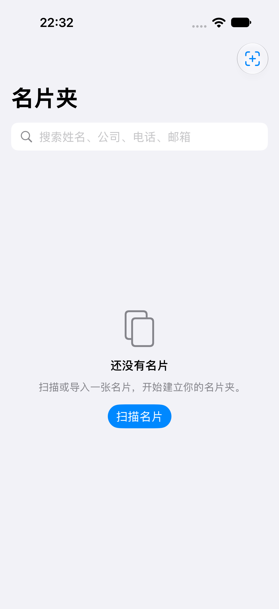
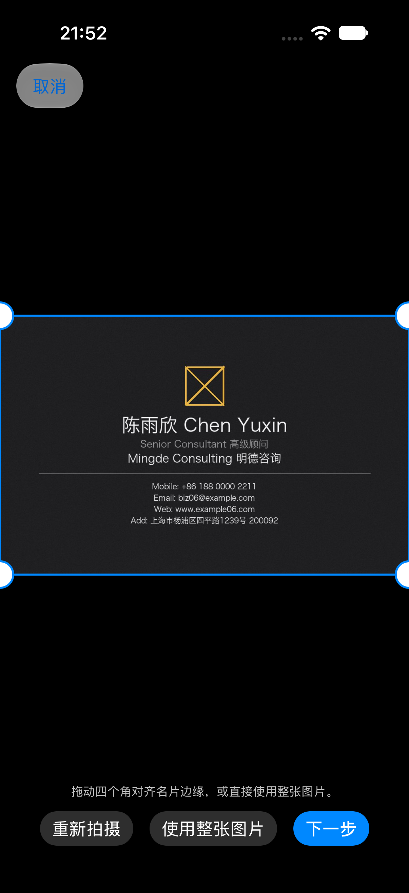
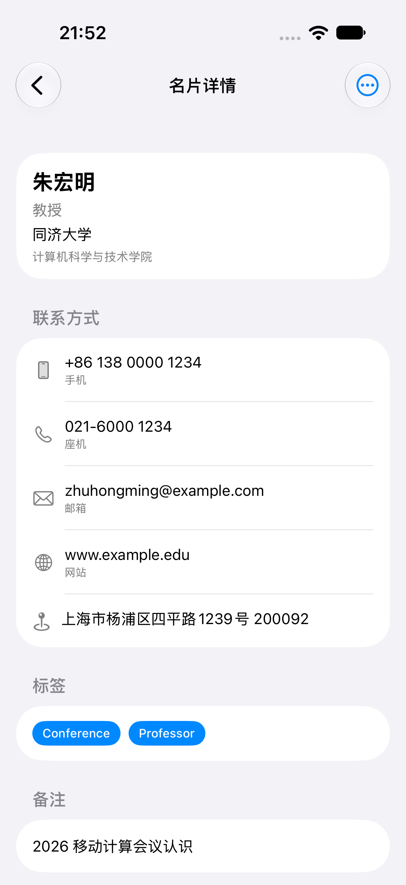

# 最终报告（草稿，随验收更新）

## 1. 我做了什么

在 iOS 上用 SwiftUI + Apple Vision 复刻了 CamCard「名片数字化 + 联系人管理」闭环：

拍摄/导入 → 名片边界检测 → 透视校正 → OCR → 8 字段结构化 → 人工确认 →
保存 → 名片夹 → 搜索/标签/备注 → 详情/编辑/删除 → 重启保持 → 导出 vCard/通讯录。

## 1.5 界面截图（iPhone 18 Pro / iOS 27.0，真机模拟器实测）

| 页面 | 截图 |
|---|---|
| 空名片夹（T01） |  |
| 名片夹列表（搜索 + 标签） |  |
| 边界检测与手动校正（T06） |  |
| 识别结果确认（T08/T10/T11） |  |
| 名片详情（T13） |  |

重新生成：`touch /tmp/capture-screenshots && xcodebuild test -only-testing:CamCardReplicaUITests/ScreenshotTests`

## 2. 怎么证明它工作

| 证据 | 位置 |
|---|---|
| 65 个单元/集成测试全绿（2026-10-27 实测） | `make test` |
| 15 个端到端 UI 测试全绿（覆盖 T01–T20，其中 T05/T18/T19 部分需真机手工补验） | `make test-ui` |
| 6 张 fixture 的整链路（图→OCR→字段）结果 | `docs/reports/ocr-accuracy.md` 第二之二节 |
| 字段准确率与幻觉率 | `docs/reports/ocr-accuracy.md` |
| 需求↔测试↔代码追溯 | `docs/spec/acceptance.md` |
| 设计决策与取舍 | `docs/architecture/adr/` |

## 3. 关键设计取舍（答辩要点）

1. **不用云 OCR / 大模型**：确定性、离线、无成本、可回归；代价是复杂版式召回有限。
2. **不用 SwiftData**：数据量小，JSON 更可检查、更可测，避免迁移风险。
3. **协议 + fixture 注入**：模拟器无摄像头也能端到端测；生产路径不含 debug 分支。
4. **宁缺勿造**：置信度低于阈值返回 nil，这是 T09 能 100% 通过的根本原因。

## 4. 数字（待填最终版）

- 单元/集成测试：65 通过 / 0 失败
- 端到端 UI 测试：15 通过 / 0 失败（总耗时约 150 秒）
- 字段准确率：name 100% / company 100% / title 100% / email 100% / website 100% /
  address 100% / mobile 100% / office 98% / fax 90%
- 幻觉率：0%
- OCR 耗时（模拟器，1024×638 图）：单张约 0.4–0.9 秒（`ScanFlowModel.timings["ocr"]`）
- 文字召回（严格整行）：0.89 平均

## 5. 已知限制

见 `docs/reports/ocr-accuracy.md` 第三节与 `AGENTS.md` 第八节。

## 6. 如果再做两周

1. 竖排/艺术字专项：接入 Vision 的姿态估计或引入版面分析。
2. 多名片同框：检测 + 逐张裁剪。
3. 端侧小模型做字段候选生成（仍需阈值 + 人工确认），并量化幻觉率变化。
4. 与 CamCard 的逐页截图对比（Golden Test）。
